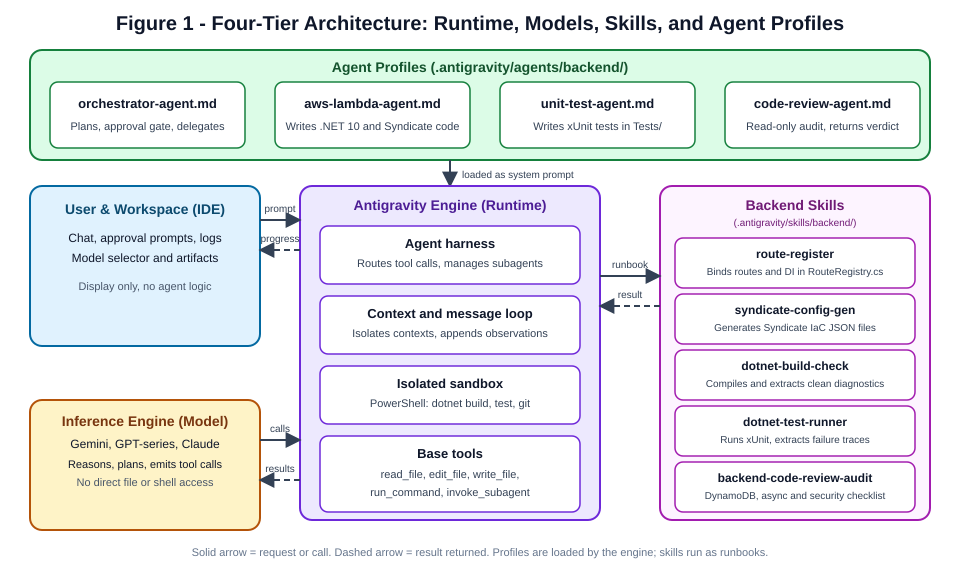
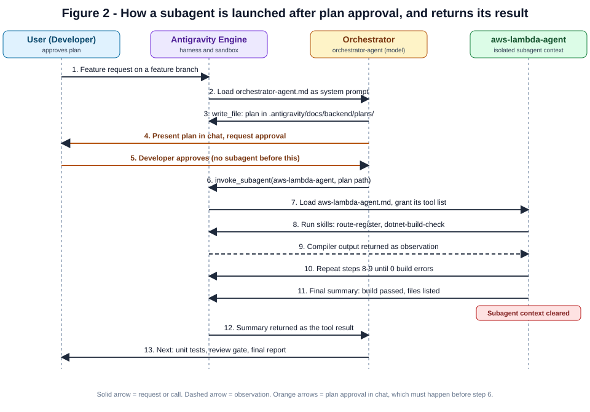
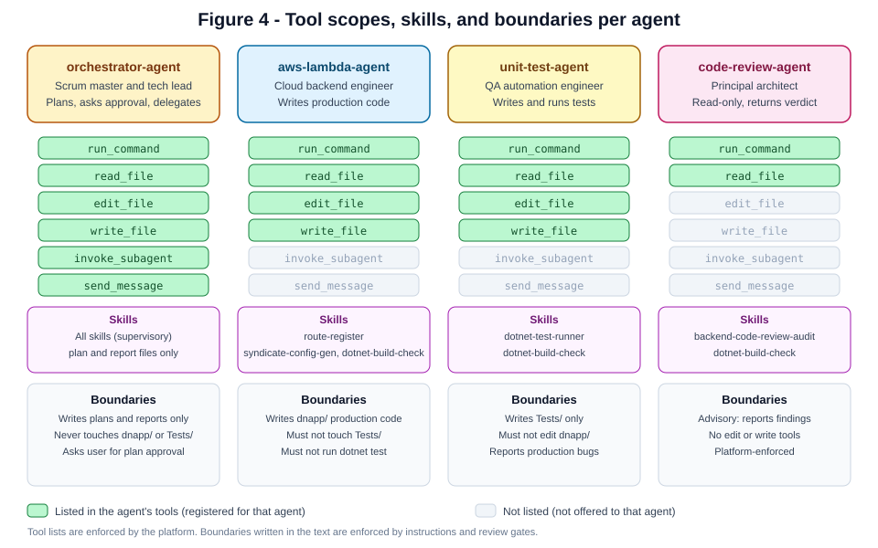
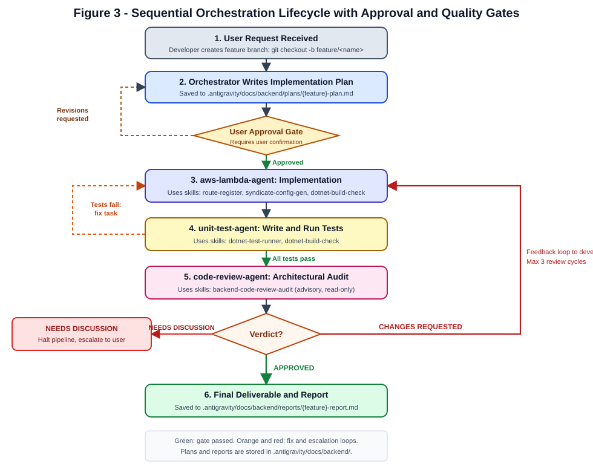

# Google Antigravity Multi-Agent Framework

## restaurant-backend-app: Architecture, Runtime Mechanics and Delivery Lifecycle

> **Scope.** This document explains how the declarative agents and backend skills of the `restaurant-backend-app` project are defined, launched, equipped with tools, and coordinated through a sequential delivery lifecycle inside Google Antigravity. It covers the model layer, the Antigravity runtime, decomposed domain skills, agent profiles, guardrails, and contracts between agents. Where useful, it compares the setup with Claude Code, which uses the same kind of agent profile files.
>
> **Diagrams.** All diagrams are SVG images in `images/` next to this file. They render in any Markdown viewer that displays images (GitHub, GitLab, IDE previews) and do not depend on Mermaid support.

---

## Table of Contents

1. [Purpose and Scope](#1-purpose-and-scope)
2. [Glossary](#2-glossary)
3. [Architecture Overview](#3-architecture-overview)
   - [3.0 What a Harness Is](#30-what-a-harness-is)
   - [3.1 Four-Tier Responsibilities](#31-four-tier-responsibilities)
   - [3.2 The Seven Steps of a Turn](#32-the-seven-steps-of-a-turn)
   - [3.3 Foundation Models](#33-foundation-models)
   - [3.4 Antigravity Engine Runtime](#34-antigravity-engine-runtime)
4. [Backend Skills Decomposition](#4-backend-skills-decomposition)
5. [How a Subagent Is Launched](#5-how-a-subagent-is-launched)
6. [Tool Binding, Permissions & Sandboxing](#6-tool-binding-permissions--sandboxing)
   - [6.1 Platform Primitives](#61-platform-primitives)
   - [6.2 Portability Across Models and Products](#62-portability-across-models-and-products)
   - [6.3 Harness Comparison: Antigravity and Claude Code](#63-harness-comparison-antigravity-and-claude-code)
   - [6.4 Terminal Sandboxing, Windows Loopback Sockets & Command Allowlisting](#64-terminal-sandboxing-windows-loopback-sockets--command-allowlisting)
7. [Agent Matrix & Role Specialization](#7-agent-matrix--role-specialization)
8. [Orchestration Delivery Lifecycle](#8-orchestration-delivery-lifecycle)
   - [8.1 Developer Git Workflow](#81-developer-git-workflow)
   - [8.2 Five-Phase Lifecycle](#82-five-phase-lifecycle)
   - [8.3 State Transition Matrix](#83-state-transition-matrix)
9. [Contracts Between Agents](#9-contracts-between-agents)
10. [Repository Layout](#10-repository-layout)
11. [Guardrails: Platform-Enforced vs. Prompt-Enforced](#11-guardrails-platform-enforced-vs-prompt-enforced)
12. [Failure Modes and Regulated Feedback Loops](#12-failure-modes-and-regulated-feedback-loops)
13. [Worked Example](#13-worked-example)
14. [Resolved Gaps, Platform Notes and Open Items](#14-resolved-gaps-platform-notes-and-open-items)
15. [Quick Reference](#15-quick-reference)

---

## 1. Purpose and Scope

The `restaurant-backend-app` project uses a multi-agent architecture to develop, test, audit, and deliver features in a .NET 10 AWS Serverless environment.

Instead of a single monolithic prompt or a generic coding assistant, work is divided across specialized roles:

- **Orchestrator Agent**: analyzes requirements, authors plans, obtains developer approval, and coordinates delivery.
- **AWS Lambda Developer Agent**: implements domain models, services, repositories, HTTP handlers, and AWS Syndicate IaC.
- **Unit Test Agent**: owns the `Tests/` suite, writing xUnit and Moq tests without touching production code.
- **Code Review Agent**: performs read-only audits covering DynamoDB index efficiency, .NET 10 async idioms, and security.

This document defines the technical contracts, runtime mechanics, skills decomposition, and verification gates that make this architecture predictable, reliable, and cost-effective.

---

## 2. Glossary

### 2.1 Core Terms

| Term | Meaning in this project |
| :--- | :--- |
| **Harness** | The software layer around a model that turns it into a working agent: the agent loop, tools, context management, sandboxing, verification gates, and state. Also called a *scaffold*. See Section 3.0. |
| **Inference engine (model)** | The language model that reasons and produces text or tool-call requests. Examples: Gemini, GPT-series, Claude models offered in the IDE. |
| **Antigravity Engine** | The platform runtime that hosts the model. It runs the message loop, executes tools, and starts and stops subagents. Also called the *runtime*. |
| **Agent profile** | A Markdown file with YAML frontmatter (name, description, tools, model) and a body that becomes the agent's system prompt. Example: `aws-lambda-agent.md`. |
| **Orchestrator** | The top-level agent (`orchestrator-agent`) that receives the user's request, writes the plan, asks for approval, and delegates work. |
| **Subagent** | An agent started by the orchestrator through the `invoke_subagent` tool. It runs in its own context. |
| **Tool call** | A structured request emitted by the model, such as `run_command` with a shell command. The model asks; the platform executes. |
| **Observation** | The result of a tool call (for example, the console output of `dotnet build`). It is appended to the context of the model that made the call. |
| **Context window** | The text the model can see during one turn: system prompt, messages, tool calls, and observations. |
| **Sandbox** | The isolated environment in which commands and file operations run (PowerShell in this project). |
| **Plan file** | The Markdown implementation plan written by the orchestrator and approved by the developer before any implementation starts. |
| **Verdict** | The single-value outcome of a code review: `APPROVED`, `CHANGES REQUESTED`, or `NEEDS DISCUSSION`. |

### 2.2 Agent vs. Skill vs. Tool

A common source of confusion is the relationship between **Tools**, **Skills**, and **Agents**. In Antigravity, these represent three distinct levels of abstraction:

| Dimension | Tool | Skill | Agent |
| :--- | :--- | :--- | :--- |
| **What is it?** | Atomic platform primitive. | High-level procedural workflow / runbook aware of project conventions. | Autonomous persona with a role, cognitive loop, and long-term objective. |
| **Analogy** | Screwdriver, wrench (`read_file`, `write_file`). | Procedure to assemble a gearbox from a blueprint. | Master mechanic who plans the repair and selects the procedure. |
| **Domain awareness** | **Zero.** Executes raw I/O. | **High.** Knows paths, naming standards, error shapes. | **Global.** Knows lifecycle, role boundaries, and feature goals. |
| **Autonomy** | None. Single action, returns immediately. | Low. Follows a structured procedural sequence. | High. Iterates: thinks, calls skills and tools, analyzes, decides the next step. |
| **Examples** | `run_command`, `read_file`, `edit_file`, `write_file`, `invoke_subagent`. | `route-register`, `syndicate-config-gen`, `dotnet-build-check`. | `orchestrator-agent`, `aws-lambda-agent`, `unit-test-agent`, `code-review-agent`. |

**Why use custom agents at all?** Specialized agents with isolated contexts keep each task's logs and intermediate edits out of the coordinating conversation, enforce project standards through profile boundaries, and create an adversarial quality check: the agent that writes production code does not evaluate its own work.

---

## 3. Architecture Overview

The system is organized into four operational tiers plus the IDE presentation layer.



### 3.0 What a Harness Is

A **harness** (or *scaffold*) is the software infrastructure surrounding the inference model that turns raw text completion into an autonomous engineering system. The model is the engine that reasons; the harness is the vehicle that lets it act. On its own, a model only produces text. It cannot read files, run a build, or remember yesterday's session. The harness supplies the agent loop, tool dispatch, sandbox execution, context isolation, and verification gates.

The harness has six components:

| Component | What it does | Where it appears in this project |
| :--- | :--- | :--- |
| **Agent loop** | Repeats: think, call a tool, read the result, check it, continue. | The orchestrator's delegate, verify, and fix loop (Section 8). |
| **Tools** | Actions the model may request: run commands, read and edit files. | The `tools:` list in each profile (Section 6). |
| **Context management** | Decides what the model sees: system prompt, task text, observations, and summaries of long history. | Each profile body is the system prompt; the orchestrator passes only the task and plan path to subagents (Section 5). |
| **Sandboxing and permissions** | Isolates actions and limits what each agent may touch. | The PowerShell sandbox, per-agent tool lists, and the `Tests/` versus `dnapp/` boundary. |
| **Verification loops** | Automatic gates (build, test, review) that must pass before a result is accepted. | The build gate, the test gate, and the review gate (Section 8.2). |
| **State and recovery** | Saves progress and allows resuming or rolling back. | The plan file with checkboxes (Section 9.1) and git history. |

> [!NOTE]
> Much of an agent's reliability comes from the harness, not only from the model. A moderately strong model inside a tight harness often produces more trustworthy results than a stronger model with weak controls. For this reason, the gates and boundaries in this project matter as much as the choice of model.

#### Harness vs. Product vs. Model

The three terms are often mixed up. They are different layers:

| Layer | Definition | Examples |
| :--- | :--- | :--- |
| **Model** | Trained weights. Text in, text out. No state between calls. | Gemini, GPT-series, Claude (as offered in the IDE) |
| **Harness** | The software loop and infrastructure around the model. Not a product by itself. | Agent loop, tool executor, sandbox, context manager |
| **Product** | A packaged harness with a user-facing interface. | Google Antigravity, Claude Code, GitHub Copilot, Cursor |

Products differ in how visible their harness is. Antigravity exposes it through an agent-first IDE with agent views and artifacts. Copilot runs much of its harness inside the editor plugin and in cloud services, so the user sees less of it. The same model can power several products, and a product can change models while keeping its harness.

### 3.1 Four-Tier Responsibilities

| Tier | Owns | Does Not Own |
| :--- | :--- | :--- |
| **IDE (Workspace and UI)** | Rendering chat, approval prompts, diff viewers, logs, model selector. | Any agent logic or orchestration rules. |
| **Inference Engine (Model)** | Reasoning, intent classification, code generation, tool call decisions. | Direct file, shell, or network access. No state between turns. |
| **Antigravity Engine (Runtime)** | Agent loop, subagent context isolation, sandbox execution, tool schema binding, profile loading. | Feature architecture decisions. Executes authorized calls only. |
| **Decomposed Skills** | Reusable, domain-specific execution runbooks. | High-level delegation or role assignments. |
| **Agent Profiles** | Personas, boundaries, tool allowlists, workflow lifecycle rules. | Code execution or platform hosting. |

### 3.2 The Seven Steps of a Turn

1. **Prompt in:** The developer or orchestrator sends a task prompt.
2. **Context assembly:** The runtime injects the agent's profile (system prompt) and its authorized tools.
3. **Model reasoning:** The inference engine analyzes the task, decides the next step, and emits a structured tool call.
4. **Harness routing:** The runtime intercepts the tool call (`run_command`, `invoke_subagent`, and so on).
5. **Execution in sandbox:** The PowerShell sandbox executes the command (for example, `dotnet build`).
6. **Observation returned:** Output, error codes, or subagent summaries are appended to context.
7. **Iteration or completion:** The loop repeats until the task is complete and a final response is produced.

### 3.3 Foundation Models

Antigravity profiles use `model: inherit`, which binds subagent execution to the model chosen in the IDE. Changing the model in one place changes it for the whole team.

- **Fast, token-efficient models** are a good default for compilation checks and test loops, where the task is mechanical and the output is checked by a gate anyway.
- **Higher-capacity models** are better suited to architectural planning, deep refactoring, and security audits, where judgment matters more than speed.

Choose the model per task in the IDE based on the phase you are running. Exact model versions change over time, so check what the IDE currently offers rather than relying on a fixed list in this document.

Comprehensive benchmarks and latency comparisons are available at [Artificial Analysis](https://artificialanalysis.ai/models).

### 3.4 Antigravity Engine Runtime

The engine has three functional parts:

- **Agent harness**: receives tool-call requests, decides whether each is a platform tool or a subagent invocation, and routes it.
- **Context and message loop**: maintains the running conversation per agent, appends observations, and enforces context isolation between parent and subagent.
- **Isolated sandbox**: executes shell commands and file operations (PowerShell): `dotnet build`, `dotnet test`, `git diff`.

---

## 4. Backend Skills Decomposition

Previously, `aws-lambda-agent` was a monolithic profile instructing the model on everything from C# syntax and DynamoDB queries to route editing and Syndicate packaging. This caused high token use, occasional syntax errors in `RouteRegistry.cs`, and mistakes in IaC JSON files.

By decomposing mechanical tasks into **Skills**, agents become lean coordinators that invoke specialized runbooks.

All backend skills reside in `.antigravity/skills/backend/`:

```text
.antigravity/skills/backend/
├── route-register/            SKILL.md  - Automates RouteRegistry.cs and DI registrations
├── syndicate-config-gen/      SKILL.md  - Generates valid AWS Syndicate IaC manifests
├── dotnet-build-check/        SKILL.md  - Compiles solution/projects and formats error diagnostics
├── dotnet-test-runner/        SKILL.md  - Runs xUnit tests and parses assertion failures and stack traces
└── backend-code-review-audit/ SKILL.md  - Architecture, DynamoDB query, and security audit checklist
```

| Skill | Purpose |
| :--- | :--- |
| `route-register` | Inserts handler instances and registers dependencies in `RouteRegistry.cs` using `ActivatorUtilities.CreateInstance<T>(provider)` without syntax mistakes. |
| `syndicate-config-gen` | Generates `lambda_config.json` with runtime `dotnet10` and `deployment_resources.json` with least-privilege IAM policies. |
| `dotnet-build-check` | Runs `dotnet build --nologo -clp:ErrorsOnly` and parses error locations `[File:Line]` so that only the relevant diagnostics enter the context. |
| `dotnet-test-runner` | Runs targeted or full-suite `dotnet test`, extracting test counts, failure reasons, and stack traces. |
| `backend-code-review-audit` | Guides static review: DynamoDB GSI usage versus `ScanAsync`, nullability, async safety, and tenant isolation. |

---

## 5. How a Subagent Is Launched

The orchestrator never modifies production files directly. It asks the runtime to start a subagent through `invoke_subagent`, and it does so only after the developer has approved the plan.



### 5.1 Step by Step

1. **Request in.** The developer submits a feature request on a feature branch. The runtime loads the orchestrator's profile as the system prompt.
2. **Plan and approval.** The orchestrator writes the plan file and presents it in chat. It pauses until the developer answers. No subagent starts before approval (Figure 2, steps 4 and 5).
3. **Tool call.** After approval, the model emits `invoke_subagent` naming `aws-lambda-agent` and the plan path. The model does not start the subagent itself; it only names it.
4. **Profile load.** The harness reads `aws-lambda-agent.md`, uses its body as the subagent's system prompt, and grants only the tools in its `tools:` list.
5. **Subagent works.** The subagent runs its skills and tools, for example `dotnet-build-check`. The sandbox executes them and returns observations.
6. **Iteration.** The subagent edits, writes, and rebuilds until its task is complete and the build reports zero errors.
7. **Final message.** The subagent produces a concise summary: build status and changed files.
8. **Context cleared.** The subagent's temporary context is discarded. Only its final output survives.
9. **Result returned.** The summary becomes the tool result of the orchestrator's `invoke_subagent` call.
10. **Orchestrator continues.** The orchestrator reads the result and moves to the next gate (tests, then review, then report).

### 5.2 What the Subagent Knows

A subagent starts with a fresh context. It does not see the orchestrator's reasoning or the full conversation. It sees:

- its own system prompt (its profile body),
- the task description passed in the `invoke_subagent` call, including the plan path,
- files it reads from the workspace,
- observations from its own tool calls and skill runs.

This is why the orchestrator must pass precise instructions: the plan file path, the exact files to touch, and the success criteria. Vague delegation is the most common source of wasted work.

### 5.3 Why Isolation Matters

- **Focus.** A subagent's context contains only its own job, which keeps it from drifting into unrelated work.
- **Cost control.** Long build logs stay inside the subagent; the orchestrator receives a summary.
- **Clean boundaries.** A previous attempt's mistakes do not leak into the next one unless the orchestrator passes them explicitly, for example review feedback during a fix loop.

---

## 6. Tool Binding, Permissions & Sandboxing

Antigravity binds tools based on the `tools:` YAML frontmatter in each agent's profile.



| Agent Profile | `run_command` | `read_file` | `edit_file` | `write_file` | `invoke_subagent` | `send_message` | Enforcement |
| :--- | :---: | :---: | :---: | :---: | :---: | :---: | :--- |
| **`orchestrator-agent`** | ✅ | ✅ | ✅\* | ✅\* | ✅ | ✅ | \*Write restricted to `.antigravity/docs/backend/` |
| **`aws-lambda-agent`** | ✅ | ✅ | ✅ | ✅ | ❌ | ❌ | Platform disallows delegation; prompt forbids `Tests/` |
| **`unit-test-agent`** | ✅ | ✅ | ✅ | ✅ | ❌ | ❌ | Platform disallows delegation; prompt forbids `dnapp/` |
| **`code-review-agent`** | ✅ | ✅ | ❌ | ❌ | ❌ | ❌ | **Platform-enforced advisory role** (no write tools) |

> [!IMPORTANT]
> `code-review-agent` has had `edit_file` and `write_file` removed from its profile. Even if the model attempts to modify code, the Antigravity engine rejects the call because the tool is absent from its function schema.

### 6.1 Platform Primitives

Tools are native runtime functions provided by Antigravity. The model does not implement them and cannot extend them.

| Tool | Purpose | Typical use in this project |
| :--- | :--- | :--- |
| `run_command` | Executes a shell command in the sandbox | `dotnet build`, `dotnet test`, `git diff` |
| `read_file` | Reads a file from the workspace | Reading `RouteRegistry.cs`, existing services, the plan file |
| `edit_file` | Changes part of an existing file | Adding a route entry, updating a service method |
| `write_file` | Creates or overwrites a file | New handler class, new plan file, new test class |
| `invoke_subagent` | Starts a subagent with a profile and a task | Orchestrator delegating to `aws-lambda-agent` |
| `send_message` | Sends a message to another agent | Orchestrator to subagent communication |

**Declarative scope.** The `tools:` list is a permission scope. During an agent's turn, the runtime registers only those tools in the model's function-calling schema. Removing a tool from the list removes the model's ability to request it; adding a tool does the reverse. The three working agents cannot start other agents, and only the orchestrator can message through the orchestrator channel.

If a tool is not in the profile, it is not part of that agent's function schema, so the model has no way to request it under normal operation.

### 6.2 Portability Across Models and Products

| Environment | Compatibility | Notes |
| :--- | :--- | :--- |
| **Gemini, GPT-series, or Claude in Antigravity** | Full (native) | Switching models keeps subagent routing and tool features. |
| **Claude Code** | Partial (format-compatible, mechanics differ) | Its subagent files use the same structure as these profiles: YAML frontmatter plus a Markdown system prompt. Tool names differ and some orchestration rules change (Section 6.3). |
| **GitHub Copilot or other external IDEs** | Not directly compatible | Copilot does not provide the `invoke_subagent` runtime hooks. Prompts must be translated into the target's own instruction format (for example, `.github/copilot-instructions.md`), and orchestration has to be rebuilt by hand. |

The important point: **the profiles are portable as text, but the orchestration is not portable as configuration.** Moving to another product means rewriting the delegation mechanics.

**Model inheritance.** Every profile sets `model: inherit`. In Antigravity this means the subagent uses the model selected in the IDE. Claude Code uses the same keyword with the same meaning, and its `model` field also accepts `sonnet`, `opus`, or `haiku`. If the field is omitted in Claude Code, subagents default to `sonnet`, which is not the same as inheriting. Keep `inherit` explicit in every profile so behavior does not depend on a default.

### 6.3 Harness Comparison: Antigravity and Claude Code

Claude Code is a product built on the same kind of harness described in Section 3.0. Its subagent mechanism is documented and close to the format used in this project, which makes it the most practical second target for these profiles.

| Aspect | Google Antigravity (current setup) | Claude Code |
| :--- | :--- | :--- |
| **Form** | Agent-first IDE | Terminal CLI, with IDE integrations |
| **Where agent profiles live** | Profile `.md` files in the project (this setup) | `.claude/agents/` (project, version-controlled, highest priority) or `~/.claude/agents/` (personal) |
| **Profile format** | YAML frontmatter plus Markdown body | YAML frontmatter plus Markdown body. `name` and `description` are required; the body is the system prompt. |
| **Tool names** | `run_command`, `read_file`, `edit_file`, `write_file`, `invoke_subagent`, `send_message` | `Bash`, `Read`, `Edit`, `Write`, `Glob`, `Grep`, plus built-in tools for delegation |
| **Allow list** | `tools:` | `tools:` (if omitted, the subagent inherits all tools) |
| **Deny list** | Not used in these profiles | `disallowedTools:` |
| **Model field** | `model: inherit` | `sonnet`, `opus`, `haiku`, or `inherit` (default `sonnet`) |
| **Can a subagent start other subagents?** | Only the orchestrator delegates in this design | **No.** Subagents cannot spawn subagents. |
| **What a subagent receives** | Its profile and the task (see Section 14.2) | Only its own system prompt plus basic environment details (working directory and similar), not the full main system prompt or history |
| **Built-in helpers** | Not used in this design | Read-only helpers such as **Explore** (codebase search, Haiku model) and **Plan** |
| **Sharing with the team** | Profiles committed to the repository | `.claude/agents/` committed to the repository |

#### Tool name mapping for porting

| Antigravity tool in these profiles | Claude Code equivalent | Note |
| :--- | :--- | :--- |
| `run_command` | `Bash` | Runs shell commands such as `dotnet build` and `git diff`. |
| `read_file` | `Read` | Same purpose. |
| `edit_file` | `Edit` | Same purpose. |
| `write_file` | `Write` | Same purpose. |
| *(not listed in these profiles)* | `Glob`, `Grep` | Search for files and text. Useful for the reviewer and the test agent. |
| `invoke_subagent` | Delegation by the main session | No separate listed tool in these profiles. Claude Code delegates from the subagent's `description`, or when the user asks. |
| `send_message` | No direct equivalent in these notes | The main session reports to the user. |

#### What changes when porting to Claude Code

1. **The orchestrator must run as the main session, not as a subagent.** Subagents cannot spawn other subagents. The three working agents become subagents, and the orchestrator profile becomes the behavior of the main conversation.
2. **Workers move to `.claude/agents/`** with their tool names changed (table above). Their bodies can stay almost unchanged.
3. **The advisory reviewer can be enforced.** `code-review-agent` can use `disallowedTools: Write, Edit`, which removes the write tools at the platform level (see Section 14.3).
4. **Path rules need a different mechanism.** A tool list controls which tools are allowed, but not which folders they may write to. Keeping the lambda agent out of `Tests/` and the test agent out of `dnapp/` still needs path-based permission rules or hooks. Check the current permission syntax in the Claude Code documentation before relying on it.
5. **Model choice can be fixed per agent.** `model: inherit` keeps the same meaning. If you prefer a fixed model per agent, for example a higher-capacity model for the orchestrator and reviewer and a faster one for the implementation and test agents, set it explicitly. This is a suggestion, not a requirement of the profiles.

### 6.4 Terminal Sandboxing, Windows Loopback Sockets & Command Allowlisting

Antigravity executes terminal commands (`run_command`) in an isolated sandbox environment by default (`proceed-in-sandbox`). Understanding how this behaves for .NET on Windows is critical for frictionless autonomous agent operation:

#### 1. Why `dotnet test` Prompts for Confirmation
- **Sandbox Isolation:** Standard Sandbox Mode blocks all external network I/O, local loopback sockets (`127.0.0.1`), and access to directories outside the workspace (e.g. `C:\Users\<user>\.dotnet\`, `AppData\Roaming\NuGet`).
- **Windows VSTest Socket Behavior:** Under Windows, `dotnet test` uses an internal local TCP socket to communicate between the CLI runner process and `testhost.exe`. In Sandbox Mode, this raises `System.Net.Sockets.SocketException (10013): An attempt was made to access a socket in a way forbidden by its access permissions`.
- **Bypass Sandbox Modal:** When the agent executes unsandboxed (`BypassSandbox: true`), Antigravity displays an interactive permission prompt in the UI: *"Allow run tests with coverage?"*.

#### 2. Configuring Frictionless Execution (Safe vs. Unsafe Approaches)

- **Recommended & Safe Approach (`Tool Permissions -> Terminal`):**
  - Navigate to **Settings -> General -> Global Permissions -> Tool Permissions**.
  - In the **Terminal** section, add the command prefix/pattern:
    ```text
    dotnet test
    ```
  - **Security Guarantee:** Antigravity auto-approves safe compilation and test runs (`dotnet build`, `dotnet test`). Destructive operations (`Remove-Item`, git branch resets, shell scripts) continue to require explicit user confirmation.
  - Alternatively, select **«Always Allow»** directly from the confirmation modal when prompted in the chat interface.

- **Unsafe Approach (Global `always-proceed`):**
  - Enabling an unrestricted `always-proceed` execution policy bypasses confirmation prompts across all terminal commands indiscriminately. If an agent encounters an edge case and attempts a destructive cleanup (e.g. `Remove-Item -Recurse` or `git reset --hard`), it will execute immediately without human oversight. **Not recommended for production or team repositories.**

---

## 7. Agent Matrix & Role Specialization

| Agent | Profile | Role | Scope | Key Skills |
| :--- | :--- | :--- | :--- | :--- |
| **Orchestrator** | `orchestrator-agent.md` | Scrum master and technical lead | Writes plans and reports in `.antigravity/docs/backend/`. Asks for approval, coordinates subagents. Never touches production code. | All skills (supervisory) |
| **AWS Lambda Dev** | `aws-lambda-agent.md` | Cloud backend engineer | Writes C# 13 / .NET 10 code in `dnapp/lambdas/`. Configures Syndicate IaC. Never touches `Tests/`. | `route-register`, `syndicate-config-gen`, `dotnet-build-check` |
| **Unit Test QA** | `unit-test-agent.md` | QA automation engineer | Writes xUnit and Moq tests in `Tests/`. Runs the test runner. Never alters production code. | `dotnet-test-runner`, `dotnet-build-check` |
| **Code Reviewer** | `code-review-agent.md` | Principal cloud architect | Read-only static analysis and security audit. Emits structured verdicts. | `backend-code-review-audit`, `dotnet-build-check` |

### 7.1 Orchestrator Agent

The orchestrator is the only agent that can delegate and talk to the developer through the chat. Its responsibilities are:

- read the relevant documentation (`howeworks/homework-backend.md`, `docs/ApiRoutes.md`, existing entities, `RouteRegistry.cs`),
- author the implementation plan and present it for approval,
- delegate in the correct order: implementation, then tests, then review,
- handle the review verdict,
- save the final report and summarize it in chat.

Its profile explicitly says it does not write production code. Its file writes are limited to plan and report files.

### 7.2 AWS Lambda Agent

This agent implements the backend. Its scope covers:

- the `api-handler` Lambda: request and response models, service interfaces and implementations, handlers implementing `IApiRequestHandler`, route registration in `Routing/RouteRegistry.cs`, and dependency injection,
- standalone Lambdas under `dnapp/lambdas/`, including `.csproj`, `Function.cs`, `lambda_config.json`, and `deployment_resources.json`,
- AWS Syndicate configuration files (`syndicate.yml`, `syndicate_aliases.yml`).

Its verification step is the build gate: `dotnet build backend/restaurant-backend-app/restaurant-backend-app.sln`. It must not create or edit anything under `Tests/` and must not run `dotnet test`.

### 7.3 Unit Test Agent

This agent owns the test project `backend/restaurant-backend-app/Tests/APIHandler.Tests.csproj`. It follows:

- test naming: `{MethodUnderTest}_{ConditionOrScenario}_{ExpectedOutcome}`,
- the Arrange-Act-Assert structure,
- `[Theory]` with `[AutoData]` for data-driven cases, `[Fact]` otherwise,
- Moq verification with `Times.Once` or `Times.Never`.

Its tests cover happy paths, validation failures, not-found cases, authorization failures, and edge cases. If it finds a bug in production code, it reports the bug rather than fixing it.

### 7.4 Code Review Agent

This agent reviews the diff against five pillars:

1. **Architecture and layering.** Handlers stay thin, services hold logic, repositories own DynamoDB calls, DTOs are separated from entities.
2. **.NET 10 and C# 13 idioms.** No blocking calls (`.Result`, `.Wait()`), correct null handling, sensible allocations.
3. **AWS serverless and DynamoDB.** Queries use keys and GSIs, full table scans are flagged, conditional writes are handled, Syndicate config is complete, IAM follows least privilege.
4. **Security and error handling.** Cognito claims and JWT checks, tenant and user isolation, no leaked secrets or stack traces, correct HTTP status mapping.
5. **Output format.** A structured report with a verdict, critical issues, improvements, positives, and an action checklist.

The agent is advisory. It reports findings and does not change code, and its tool list confirms that (no write tools).

---

## 8. Orchestration Delivery Lifecycle

### 8.1 Developer Git Workflow

The human developer creates and switches to a dedicated feature branch **before** initiating any AI task:

```powershell
# Before starting: create feature branch
git checkout main && git pull origin main
git checkout -b feature/ai-add-menu

# After AI completes all phases: commit and push
git add .
git commit -m "feat(backend): implement menu endpoints with unit tests and syndicate config"
git push -u origin feature/ai-add-menu
```

### 8.2 Five-Phase Lifecycle

The delivery lifecycle enforces strict verification gates between phases.



**Phase 1: Intake, Plan and User Approval Gate**
1. Orchestrator inspects requirements (`howeworks/homework-backend.md`, `docs/ApiRoutes.md`).
2. Authors an implementation plan at `.antigravity/docs/backend/plans/{feature-name}-plan.md`.
3. **MANDATORY:** Presents the plan to the user and pauses. No subagent is invoked until explicit approval. If the developer asks for changes, the plan is revised and presented again (the "Revisions requested" loop in Figure 3).

**Phase 2: Implementation (`aws-lambda-agent`)**
1. Orchestrator invokes `aws-lambda-agent` with the plan path and target file list.
2. Agent implements models, services, repositories, handlers, and Syndicate configs using `route-register` and `syndicate-config-gen`.
3. Validates compilation via `dotnet-build-check`. Gate: 0 errors.

**Phase 3: Unit Testing (`unit-test-agent`)**
1. Orchestrator invokes `unit-test-agent` with newly created service and handler signatures.
2. Agent writes tests in `Tests/` and runs them via `dotnet-test-runner`.
3. **Gate:** If tests fail, the orchestrator routes the failure traces back to `aws-lambda-agent` as a fix task. Work does not proceed to review until 100% of tests pass.

**Phase 4: Code Review (`code-review-agent`)**
1. Orchestrator invokes `code-review-agent` to inspect `git diff` via `backend-code-review-audit`.
2. Evaluates DynamoDB indexing, async safety, and tenant security.
3. **Verdict handling:**
   - **`APPROVED`**: proceed to Phase 5.
   - **`CHANGES REQUESTED`**: fix loop back to `aws-lambda-agent`, capped at **3 cycles**.
   - **`NEEDS DISCUSSION`**: halt the pipeline and prompt the user for a decision.

**Phase 5: Final Report**
1. Orchestrator saves the report at `.antigravity/docs/backend/reports/{feature-name}-report.md`.
2. Presents a clickable executive summary in chat: modified files, test metrics, review verdict.

### 8.3 State Transition Matrix

| Current State | Trigger | Next State | Action |
| :--- | :--- | :--- | :--- |
| Intake | Plan generated | User Approval Gate | Display plan link; wait for approval. |
| User Approval Gate | Approved | Phase 2 (Implementation) | Invoke `aws-lambda-agent`. |
| User Approval Gate | Revisions requested | Phase 1 (Intake) | Refine plan and re-prompt user. |
| Implementation | Build succeeds (0 errors) | Phase 3 (Testing) | Invoke `unit-test-agent`. |
| Implementation | Build fails | Phase 2 (Implementation) | `aws-lambda-agent` fixes via `dotnet-build-check`. |
| Testing | All tests green | Phase 4 (Review) | Invoke `code-review-agent`. |
| Testing | Tests fail | Phase 2 (Implementation) | Forward failure stack trace to `aws-lambda-agent` as fix task. |
| Review | `APPROVED` | Phase 5 (Reporting) | Save report and summarize. |
| Review | `CHANGES REQUESTED` (up to 3 cycles) | Phase 2 (Implementation) | Forward findings, re-test, re-review. |
| Review | `CHANGES REQUESTED` (after 3 cycles) | Escalation | Stop loop; present unresolved diffs to user. |
| Review | `NEEDS DISCUSSION` | Escalation | Halt pipeline; present trade-offs to user. |

---

## 9. Contracts Between Agents

Agents communicate through persisted disk artifacts and structured tool calls.

### 9.1 Plan Contract
- **Path:** `.antigravity/docs/backend/plans/{feature-name}-plan.md`
- **Owner:** `orchestrator-agent`
- **Content:** Feature overview, API contract (route, method, request body, response JSON, status codes), DTOs, handler and service breakdown, DynamoDB GSI details, testing strategy, and task checkboxes `[ ]`.
- **Lifecycle:** Written before approval, updated on revision, and checked off as tasks complete. A subagent should be able to start from the plan path alone.

### 9.2 Implementation and Test Handoffs
- **Implementation task:** Orchestrator supplies plan path, target file list, architecture rules, and the `dotnet-build-check` verification command. Explicitly prohibits touching `Tests/`.
- **QA test task:** Orchestrator supplies new service and handler signatures, expected error cases, and the `dotnet-test-runner` command.

### 9.3 Review Verdict Contract

`code-review-agent` output **must** begin with:

```markdown
## Code Review Summary: [Component / Feature Name]

### 🚦 Verdict
- **APPROVED** / **CHANGES REQUESTED** / **NEEDS DISCUSSION**
```

All three verdicts are handled in the orchestrator state machine (Section 8.3).

### 9.4 Final Report Contract
- **Path:** `.antigravity/docs/backend/reports/{feature-name}-report.md`
- **Owner:** `orchestrator-agent`
- **Content:** Status summary, clickable links to modified files, test execution metrics, review audit findings, and git branch instructions.

---

## 10. Repository Layout

```text
epam-it-marathon-2026/
├── .antigravity/
│   ├── agents/backend/
│   │   ├── orchestrator-agent.md               # Lead coordinator
│   │   ├── aws-lambda-agent.md                 # .NET 10 and IaC developer
│   │   ├── unit-test-agent.md                  # QA automation engineer
│   │   └── code-review-agent.md                # Advisory reviewer (read-only)
│   ├── skills/backend/
│   │   ├── route-register/SKILL.md             # Route and DI binding runbook
│   │   ├── syndicate-config-gen/SKILL.md       # AWS Syndicate IaC generator
│   │   ├── dotnet-build-check/SKILL.md         # Solution build verification
│   │   ├── dotnet-test-runner/SKILL.md         # xUnit runner and failure parser
│   │   └── backend-code-review-audit/SKILL.md  # Architectural audit checklist
│   └── docs/backend/
│       ├── antigravity-agentic-framework-architecture.md   # This document
│       ├── images/                             # SVG architectural diagrams
│       ├── plans/
│       │   └── {feature-name}-plan.md          # Plans awaiting or holding approval
│       └── reports/
│           └── {feature-name}-report.md        # Persistent delivery reports
├── howeworks/
│   └── homework-backend.md                     # Domain requirements and user stories
├── docs/
│   └── ApiRoutes.md                            # Global API route documentation
└── backend/restaurant-backend-app/
    ├── restaurant-backend-app.sln              # Primary .NET 10 solution
    ├── deployment_resources.json               # Root AWS Syndicate config
    ├── dnapp/lambdas/
    │   ├── api-handler/                        # API Gateway proxy Lambda
    │   │   ├── Function.cs                     # Entry point
    │   │   ├── Routing/RouteRegistry.cs        # Route and DI mappings
    │   │   ├── Handlers/{Domain}/              # IApiRequestHandler implementations
    │   │   ├── Services/{Domain}/              # Business logic and interfaces
    │   │   ├── Repositories/                   # DynamoDB data access
    │   │   └── Models/{Domain}/                # Request and response DTOs
    │   ├── reports-handler/                    # SQS-driven Lambda for report generation
    │   └── report-sender/                      # SQS and SNS Lambda for notifications
    └── Tests/
        └── APIHandler.Tests.csproj             # xUnit test project
```

---

## 11. Guardrails: Platform-Enforced vs. Prompt-Enforced

| Rule | Affected Agent | Enforcement |
| :--- | :--- | :--- |
| Only orchestrator can start subagents | Working agents | **Platform.** `invoke_subagent` omitted from their tool list. |
| Reviewer cannot modify files | `code-review-agent` | **Platform.** `write_file` and `edit_file` removed from profile. |
| Working agents cannot message user | Working agents | **Platform.** `send_message` omitted; direct chat reserved for orchestrator. |
| No subagent before plan approval | Orchestrator | **Prompt-enforced.** Profile requires the approval pause in Phase 1. |
| Lambda dev cannot edit `Tests/` | `aws-lambda-agent` | **Prompt-enforced.** Verified via git diff during code review. |
| Test agent cannot edit production code | `unit-test-agent` | **Prompt-enforced.** Verified via git diff during code review. |
| Orchestrator writes only plans and reports | `orchestrator-agent` | **Prompt-enforced.** Profile forbids touching `dnapp/` or `Tests/`. |
| Zero compiler errors gate | Pipeline | **Verification gate.** Checked via `dotnet-build-check` before the QA phase. |
| 100% test pass gate | Pipeline | **Verification gate.** Checked via `dotnet-test-runner` before the review phase. |

> [!WARNING]
> Everything about *what files each agent may touch* and *what gates must pass* is enforced by instructions, not by the platform. A misbehaving model could cross a file boundary without the platform stopping it. The mitigations are the review gate, the git diff, and the test suite.

**Claude Code note.** Claude Code can express the reviewer's read-only role with `disallowedTools: Write, Edit`. Path-based rules (for example, "no writes under `Tests/`") need permission rules or hooks; see Section 6.3.

---

## 12. Failure Modes and Regulated Feedback Loops

| Failure | Detection Point | Handling Protocol |
| :--- | :--- | :--- |
| C# compilation errors | Phase 2 | `aws-lambda-agent` reads compiler output via `dotnet-build-check` and iterates until 0 errors remain. |
| Unit test assertion failures | Phase 3 | `unit-test-agent` captures the failure stack trace; orchestrator routes a bug-fix task to `aws-lambda-agent`; tests are re-executed. |
| Review requests changes | Phase 4 | Orchestrator forwards findings to `aws-lambda-agent`, re-runs tests, and re-audits. **Capped at 3 cycles.** |
| Review returns `NEEDS DISCUSSION` | Phase 4 | Orchestrator halts the pipeline, presents options to the user, and waits for an explicit decision. |
| Excessive fix iterations (more than 3) | Phase 4 | Orchestrator stops the automatic loop and escalates unresolved findings to the developer. |
| Developer requests revisions to the plan | Phase 1 | Plan is revised and presented again. No subagent runs until approval. |

---

## 13. Worked Example

**Feature request:** "Add endpoint to fetch menu categories."

1. **Pre-task:** Developer creates branch: `git checkout -b feature/ai-menu-categories`.
2. **Phase 1, planning:** Orchestrator reads `docs/ApiRoutes.md`, designs `GET /dishes/categories`, creates `.antigravity/docs/backend/plans/menu-categories-plan.md`, and requests approval in chat.
3. **Approval gate:** Developer responds: *"Approved, proceed."*
4. **Phase 2, implementation:** Orchestrator invokes `aws-lambda-agent`. The agent creates `GetDishCategoriesHandler.cs`, uses `route-register` to bind the route in `RouteRegistry.cs`, and verifies with `dotnet-build-check`: **PASS**.
5. **Phase 3, QA testing:** Orchestrator invokes `unit-test-agent`. The agent writes `GetDishCategoriesHandlerTests.cs` and runs `dotnet-test-runner`: **4 tests pass**.
6. **Phase 4, code review:** Orchestrator invokes `code-review-agent`. The reviewer checks `git diff` and verifies there are no unindexed DynamoDB scans. Verdict: **`APPROVED`**.
7. **Phase 5, report:** Orchestrator saves the report to `.antigravity/docs/backend/reports/menu-categories-report.md` and summarizes it in chat.
8. **Developer wrap-up:**
   ```powershell
   git add .
   git commit -m "feat(dishes): add get categories endpoint and unit tests"
   git push -u origin feature/ai-menu-categories
   ```

*Variant: if the review had returned `CHANGES REQUESTED` for a table scan on a non-key attribute, the orchestrator would send the finding to `aws-lambda-agent` (switch to a GSI query), re-run the tests, and request a second review. The cycle counts toward the 3-cycle cap.*

---

## 14. Resolved Gaps, Platform Notes and Open Items

### 14.1 Resolved Profile Gaps

| # | Gap | Resolution |
| :--- | :--- | :--- |
| 1 | `NEEDS DISCUSSION` verdict not handled | Formally integrated: orchestrator halts and prompts the user. |
| 2 | Test failure had no return path | Concrete path established: failing tests route to `aws-lambda-agent` as a fix task. |
| 3 | No cap on the fix loop | Strict maximum of 3 review cycles; then escalate to the user. |
| 4 | Reviewer had write tools | `edit_file` and `write_file` removed from `code-review-agent.md`. Platform-enforced. |
| 5 | Orchestrator scope unclear | `write_file` and `edit_file` restricted to `.antigravity/docs/backend/` by profile. |
| 6 | Path `howeworks/homework-backend.md` unclear | Checked against the repository; this is the correct path. |
| 7 | Inconsistent model naming | Standardized on `model: inherit` across all profiles. |

### 14.2 Platform Behaviors (Project Notes)

These behaviors are recorded by the project team. Re-confirm them against the current Antigravity documentation when the platform or the models change.

- **Context isolation:** Subagents run in isolated conversation contexts. Only the final message returns to the parent; intermediate build logs and edits are discarded. Claude Code documents the same principle: a subagent receives only its own system prompt plus basic environment details.
- **Unregistered tool prevention:** Tools omitted from an agent's `tools:` frontmatter are absent from the model's function schema, so the model has no way to call them.
- **`send_message` semantics:** In Antigravity, `send_message` is for agent-to-agent communication. User communication uses direct markdown output in the conversation.
- **`model: inherit` resolution:** Subagents inherit the model selected in the IDE. Mid-session model switches apply to all subsequent subagent invocations.

### 14.3 Open Items

These are not yet covered by the profiles. Decide each one before relying on the behavior.

1. **Test-fix loop has no cap.** The review loop is capped at 3 cycles, but the test-failure loop (Phase 3) is not. Decide whether test-fix cycles count toward the same cap.
2. **Orchestrator write scope is prompt-enforced.** The orchestrator has `write_file` and `edit_file`, and its write path is restricted only by its profile text. A platform-level path rule would be stronger if the product supports one.
3. **Reviewer enforcement in Claude Code.** When porting, use `disallowedTools: Write, Edit` for `code-review-agent`, so the advisory role is enforced by the platform there too.
4. **Skills access.** The tool chips do not show how skills are granted to each agent. Confirm whether skills are loaded through the profile, through `run_command`, or through a separate mechanism, and document it.
5. **Model names.** Exact model versions change over time. Keep this document generic ("the model selected in the IDE") and record specific versions only in the team's setup notes.
6. **Subagent failure handling.** Confirm how a crashed or timed-out subagent is reported back to the orchestrator, and add the answer to Section 12.
7. **`send_message` and approval.** Confirm that the approval pause in Phase 1 is a plain chat exchange and not a `send_message` call, so the behavior is the same across products.

---

## 15. Quick Reference

### 15.1 Commands

```powershell
# Start feature branch
git checkout -b feature/<name>

# Compile solution (build gate)
dotnet build backend/restaurant-backend-app/restaurant-backend-app.sln --nologo -clp:ErrorsOnly

# Run targeted tests
dotnet test backend/restaurant-backend-app/Tests/APIHandler.Tests.csproj --filter "FullyQualifiedName~{TestClass}" --nologo

# Run full test suite (test gate)
dotnet test backend/restaurant-backend-app/Tests/APIHandler.Tests.csproj --nologo

# Inspect changes for review
git status && git diff
```

### 15.2 Orchestrator Checklist (per feature)

- [ ] Feature branch created before starting
- [ ] Plan file exists at `.antigravity/docs/backend/plans/{feature-name}-plan.md`
- [ ] **User has approved the plan** (no subagent before this)
- [ ] Task to `aws-lambda-agent` includes plan path, file list, build verification command, and `Tests/` prohibition
- [ ] Build gate passed (0 errors) before invoking the test agent
- [ ] Test gate passed (100%) before invoking the review agent
- [ ] Review verdict is one of the three defined values and is handled
- [ ] Fix loops counted and capped at 3 for review
- [ ] Final report saved to `.antigravity/docs/backend/reports/{feature-name}-report.md`

### 15.3 Path Cheat Sheet

| Purpose | Location |
| :--- | :--- |
| Agent profiles | `.antigravity/agents/backend/{name}.md` |
| Backend skills | `.antigravity/skills/backend/{skill-name}/SKILL.md` |
| Feature plans | `.antigravity/docs/backend/plans/{feature-name}-plan.md` |
| Feature reports | `.antigravity/docs/backend/reports/{feature-name}-report.md` |
| Solution file | `backend/restaurant-backend-app/restaurant-backend-app.sln` |
| API handler code | `backend/restaurant-backend-app/dnapp/lambdas/api-handler/` |
| Unit tests | `backend/restaurant-backend-app/Tests/` |
| Domain requirements | `howeworks/homework-backend.md` |
| API route reference | `docs/ApiRoutes.md` |
| Harness and Claude Code notes | Sections 3.0 and 6.3 of this document |
