# 🍽️ Green & Tasty — EPAM IT Marathon 2026

> **Dates:** October 19 – November 6, 2026  
> **Event:** [EPAM IT Marathon 2026](https://campus.epam.com/en/event/191)  
> **Project:** GreenTasty — cloud-based restaurant table reservation and group pre-order system.

As part of the marathon track, all workshops and webinars were completed, followed by delivering a full end-to-end software development lifecycle (Full SDLC): from business analysis and UX design to cloud infrastructure, AI agent-driven backend development, frontend implementation, and manual/automated quality assurance.

---

## 🚀 Development Stages

### 1. 📋 Business Analysis (Software Requirements)
- **Materials:** [`howeworks/business-analysis/`](howeworks/business-analysis/)
- **Summary:** Analyzed business requirements for the **Group Pre-order** module. Formulated detailed User Stories (**US_New_1, US_New_2, US_New_3A**) with clear Acceptance Criteria (AC), preconditions, user roles (Order Owner / Guest), rules for aggregating participant subcarts, removing guests, and generating one-time guest edit links.

### 2. 🎨 UI/UX Design
- **Materials:** [`howeworks/homework-UI-UX-design.md`](howeworks/homework-UI-UX-design.md)
- **Figma Design:** [View Figma Solution](https://www.figma.com/design/qpNIjHnMIHkhFbFH9qn7fg/EPAM-IT-Marathon-6.0--Copy-?node-id=115001-49572&t=WCjGvs8bvNfCtnA3-1)
- **Summary:** Designed the Order Owner Cart screen integrating invited guest subcarts using **AI Figma Make** and **Figma**. Designed pre-order submission statuses ("Submitted" / "Still choosing"), warning banners, guest removal confirmation dialogs, and responsive layouts for mobile viewports.

### 3. ☁️ DevOps & Cloud Infrastructure
- **Materials:** [`howeworks/homework-devops-cloud-infrastructure.md`](howeworks/homework-devops-cloud-infrastructure.md)
- **Summary:** Explored and utilized core **AWS** services (Lambda, API Gateway, DynamoDB, Cognito, S3, CloudFront, Budgets), **AWS Syndicate** framework, and **Terraform** (IaC). Cloud infrastructure was provisioned from scratch, deployed, and interconnected:
  - 🌐 **Frontend (S3 + CloudFront):** [https://d21fik7wr2oipe.cloudfront.net](https://d21fik7wr2oipe.cloudfront.net)
  - ⚙️ **Backend API (API Gateway + Lambda):** [https://kdjjot9ejh.execute-api.eu-north-1.amazonaws.com/develop](https://kdjjot9ejh.execute-api.eu-north-1.amazonaws.com/develop)

### 4. ⚙️ Backend Development
- **Materials:** [`howeworks/backend/`](howeworks/backend/)
- **Summary:** Built a REST API on **.NET 10 (C# 13)** in a serverless **AWS Lambda** architecture backed by **Amazon DynamoDB**. Developed using the **Google Antigravity Multi-Agent Framework** (a 4-agent team: Orchestrator, Lambda Dev, Unit Test, Code Review) and specialized modular skills (`route-register`, `syndicate-config-gen`, `dotnet-test-runner`). Delivered Levels 1–3 (guest session aggregation, consolidated order submission, participant removal) with 100% xUnit test pass rate.

### 5. 💻 Frontend Development
- **Materials:** [`howeworks/frontend/`](howeworks/frontend/)
- **Summary:** Developed a Single Page Application on **Angular 22** featuring a reactive signal architecture (`signal()`, `computed()`) and **RxJS**. Delivered the group pre-order page `/reservations/:id/group-order`, participant cards with live total recalculations, silent background polling sync, confirmation modals, and real AWS API Gateway + Cognito authentication integration. Completed Practice, Levels 1–3, and Bonus.

### 6. 🧪 QA (Manual Testing)
- **Materials:** [`howeworks/qa/`](howeworks/qa/) | **Test Cases & Defects:** [`homework-qa.xlsx`](howeworks/qa/homework-qa.xlsx)
- **Summary:** Conducted requirements analysis for US11 (guest reservation flow), identifying and resolving specification gaps regarding unavailable item statuses (On Stop / Out of Stock). Designed 10 comprehensive test cases, executed manual test suites, and logged defect reports.

### 7. 🤖 Automated Testing
> *Placeholder — automated testing scenarios and verification suites (E2E / Integration tests) will be added here upon completion.*

---

## 🛠️ Marathon Tech Stack

- **Backend:** .NET 10 (C# 13), AWS Lambda, Amazon DynamoDB, AWS Cognito
- **Frontend:** Angular 22, TypeScript, RxJS, SCSS
- **Cloud & IaC:** AWS (API Gateway, S3, CloudFront, Budgets), Terraform, AWS Syndicate
- **AI & Tools:** Google Antigravity IDE (Agentic Framework & Skills), Figma & AI Make
- **Testing:** xUnit, Moq, Manual QA (Test Cases & Defect Tracking)

---

## 🎓 Marathon Certificate

<!-- Placeholder for Marathon Certificate -->
_The certificate will be uploaded here once the marathon results are officially published._

---

## 📁 Project Structure

```text
epam-it-marathon-2026/
├── backend/       # AWS Lambda microservices (.NET 10) & DynamoDB/Cognito seed scripts
├── frontend/      # Client web application (Angular 22)
├── infra/         # Infrastructure as Code manifests (Terraform)
├── howeworks/     # Stage reports and deliverables (BA, UI/UX, DevOps, Backend, Frontend, QA)
└── docs/          # Product documentation and screenshots
```

---

## 📸 Product Screenshots

### 01. Home Page: Popular Dishes & Restaurant Locations
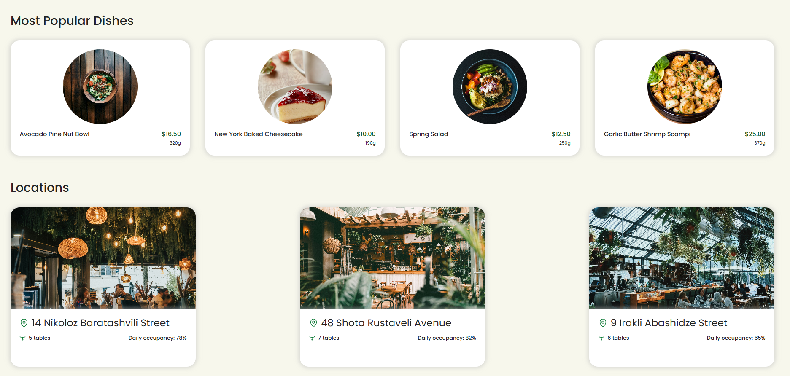

### 02. Location Details, Rating & Guest Reviews
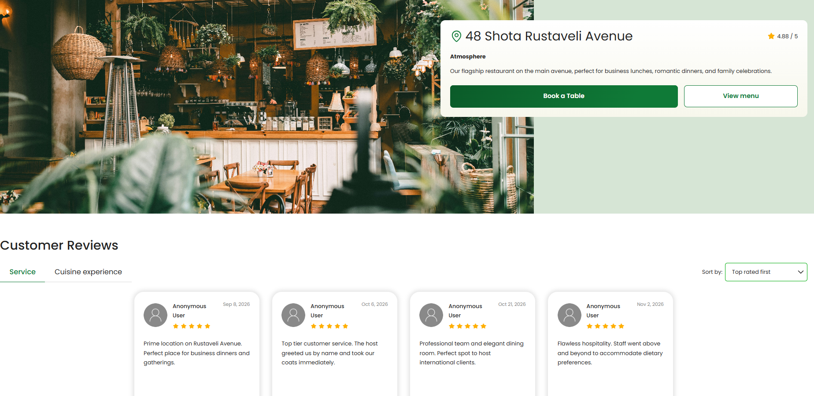

### 03. User Account Registration
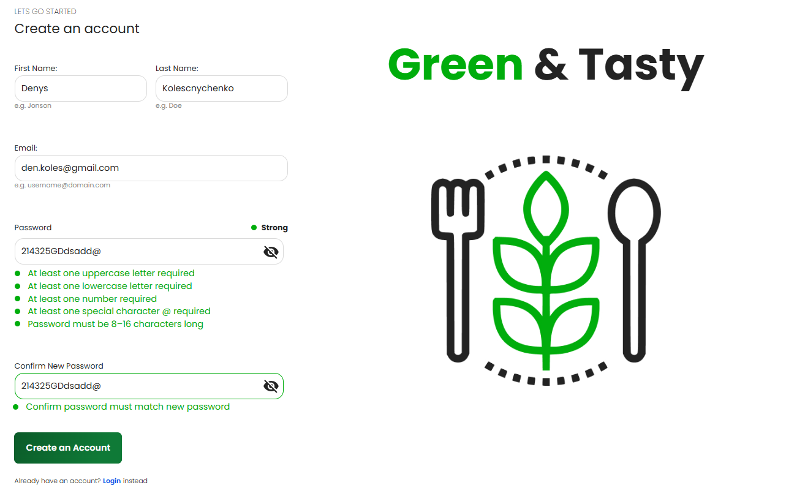

### 04. Sign In Modal Dialog
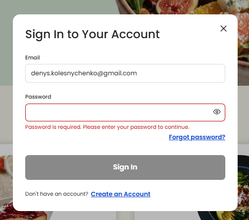

### 05. Table Reservation & Time Slot Selection
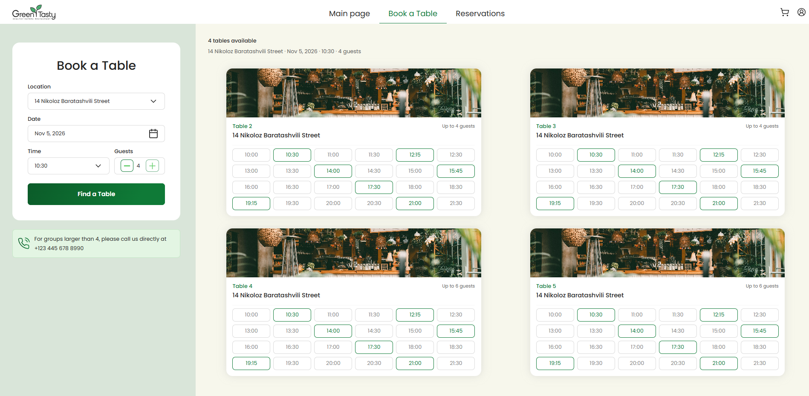

### 06. Reservation Confirmation & Guest Invite Link
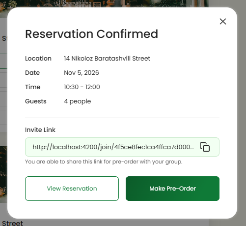

### 07. Restaurant Menu, Categories & Dish Pre-Ordering
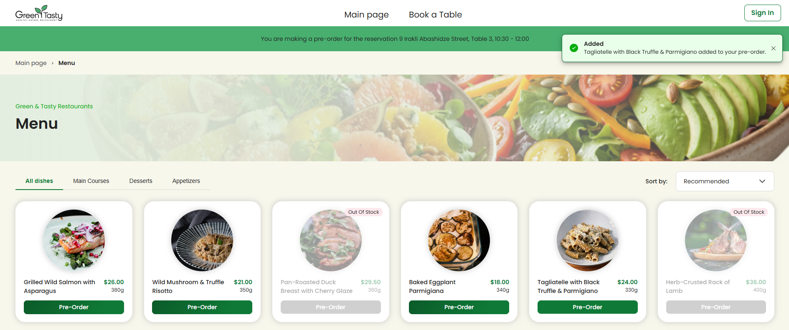

### 08. Guest Personal Pre-Order Cart Drawer
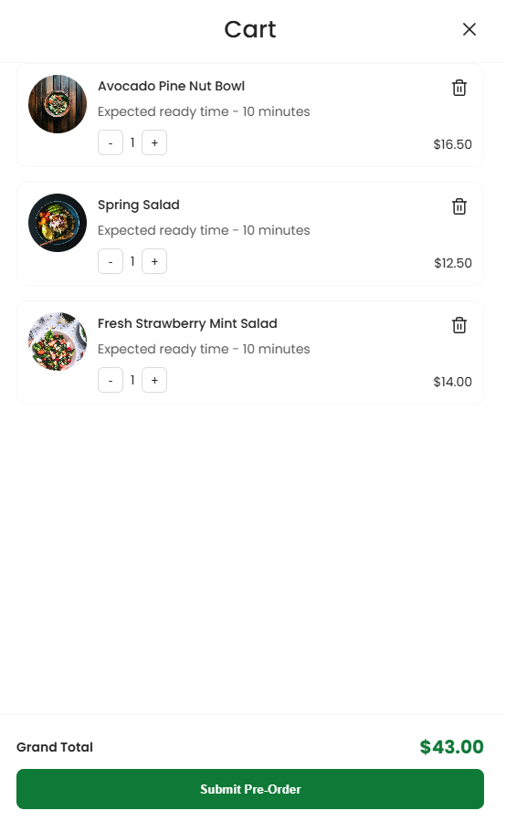

### 09. Guest Pre-Order Submission Confirmation
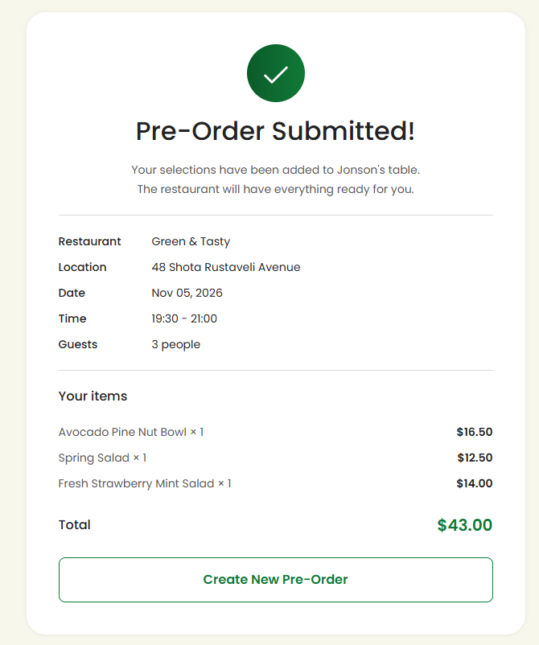

### 10. Table Owner Group Pre-Order Management View
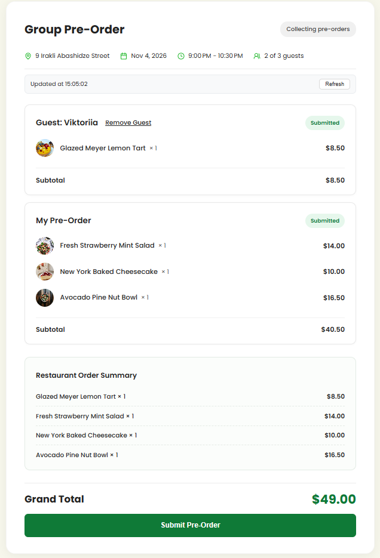

### 11. Edit Reservation Modal Dialog
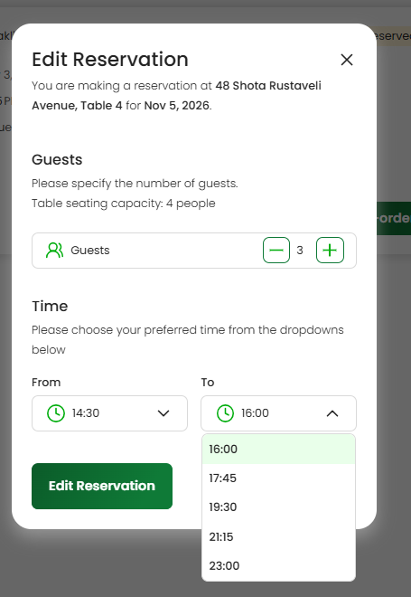

### 12. Customer Portal: Reservations Dashboard
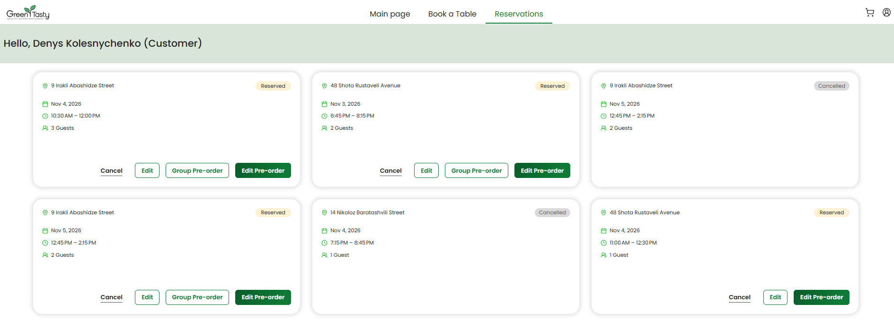

### 13. Waiter Portal: Tables & Orders Management
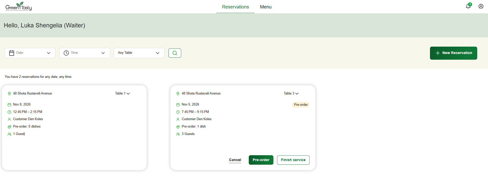
