## 1. About the project

This project is an automated test framework (AQA) for the **Green & Tasty** restaurant app. The app has a backend (API) and a frontend (UI). The tests check **end-to-end (E2E)** flows. An E2E test follows the full path a real user takes, from start to finish.

The homework is about a **group pre-order**. Here is the business idea:

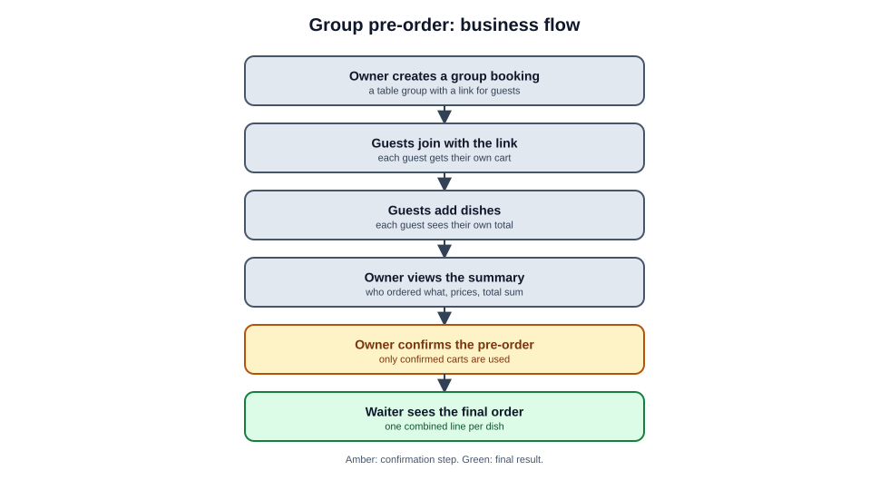

- **Owner**: the person who creates the group and confirms the order.
- **Guest**: a person in the group who picks dishes.
- **Waiter**: the person who sees the final order.

---

## 2. What a framework is and who wrote it

### A framework in simple words

A **framework** is a ready-made structure with tools and rules. You add your own logic on top of it. This framework already knows how to:

- open a browser and control it;
- send HTTP requests to the backend;
- read scenarios written in Gherkin and connect them to code;
- run tests and make reports;
- clean up test data after each test.

You do not write these tools yourself. You write the scenarios and the code for the parts you need.

### Who wrote it

- **The structure** (folders, base classes like `Actor`, `BrowseTheWeb`, and the hooks) was written by the course authors. They put ready libraries together into one setup for the restaurant app.
- **The libraries** (Reqnroll, TUnit, Playwright, and others) were written by other teams. They are open for anyone. The project uses them as NuGet packages.
- **The tests and scenarios for your homework** are written by you.

### Why AQA frameworks are custom

Web apps have Angular or React because the whole app runs in one place (the browser) and uses one language. Test automation is different:

- some projects test only the UI, others only the API, and others test gRPC, mobile apps, or databases;
- companies choose different languages (Java, C#, Python, TypeScript);
- some teams want BDD with Gherkin, and others write plain tests.

So AQA teams usually build their own setup from specialized libraries for one product. The ideas behind it (Gherkin, Screenplay, Page Objects, Playwright) are the same in any language.

---

## 3. Stack: what Reqnroll, Gherkin, Playwright and TUnit are

| Tool | What it is | Role in this project | Java equivalent |
|---|---|---|---|
| **C# / .NET 10** | The programming language and platform | All the framework code | Java 21 |
| **Gherkin** | A text format for scenarios (`Given / When / Then`) | `.feature` files in `Features/`. No code | Gherkin (the same) |
| **Reqnroll** | A BDD engine (successor of SpecFlow) | Reads `.feature` files and calls the matching C# method | Cucumber for Java |
| **Playwright (.NET)** | A Microsoft library for controlling browsers and sending HTTP | UI: clicks, typing, checks on the page. API: HTTP requests | Playwright for Java (or Selenium) |
| **TUnit** | A test runner for .NET | Runs tests, marks them passed or failed, makes reports | JUnit 5 / TestNG |
| **Bogus** | A random test data generator | Names, emails, phone numbers for test data | Datafaker |
| **dotenv.net** | Reads the `.env` file | The `UI_URL`, `API_URL` and logins | dotenv |
| **FluentAssertions** | Readable checks | `user.Should().Be("Waiter")` | AssertJ |

None of these tools use AI. They are normal libraries that do exact, defined work.

---

## 4. The flow: from text to a check

Each step in a test goes through the same layers:

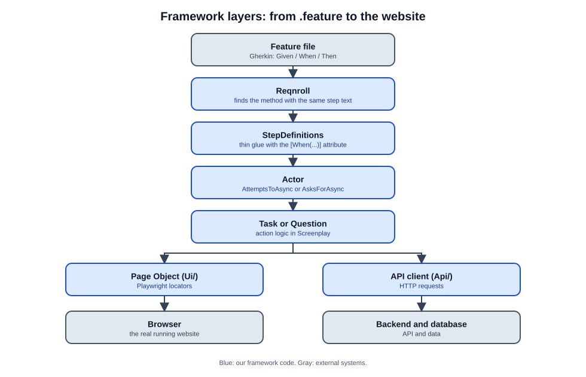

The same flow over time, for a waiter who signs in:

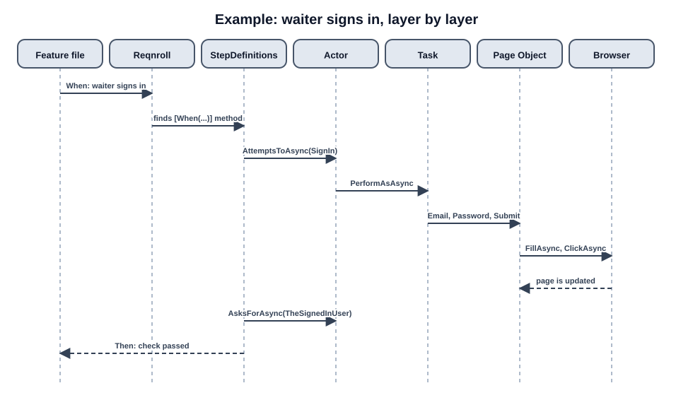

### The files of one scenario

**1. The scenario, `Features/Auth.feature`** (business language, no code):

```gherkin
@ui @smoke
Scenario: A waiter signs in on the storefront
  When the waiter signs in with the correct password
  Then the waiter is signed in
```

**2. The step translator, `StepDefinitions/AuthStepDefinitions.cs`** (the glue):

```csharp
[When("the waiter signs in with the correct password")]
[Scope(Tag = "ui")]
public async Task WhenTheWaiterSignsIn()
{
    var waiter = Actor.Recall<WaiterSession>();   // get the waiter data from actor memory
    await Actor.AttemptsToAsync(new SignInThroughTheLoginForm(waiter.Username, waiter.Password));
}
```

**3. The task, `Screenplay/Tasks/SignInThroughTheLoginForm.cs`** (what the actor does):

```csharp
public class SignInThroughTheLoginForm : ITask
{
    private readonly string _username;
    private readonly string _password;

    public SignInThroughTheLoginForm(string username, string password)
    {
        _username = username;
        _password = password;
    }

    public async Task PerformAsAsync(Actor actor)
    {
        var page = actor.LookingAtThePage();      // the browser page from the BrowseTheWeb ability
        var loginPage = new LoginPage(page);      // the Page Object for this page
        await loginPage.EnterEmailAsync(_username);
        await loginPage.EnterPasswordAsync(_password);
        await loginPage.ClickSubmitAsync();
    }
}
```

**4. The Page Object, `Ui/LoginPage.cs`** (how to find the elements):

```csharp
public class LoginPage
{
    private readonly IPage _page;
    public LoginPage(IPage page) => _page = page;

    private ILocator EmailInput    => _page.GetByRole(AriaRole.Textbox, new() { Name = "Email" });
    private ILocator PasswordInput => _page.GetByRole(AriaRole.Textbox, new() { Name = "Password" });
    private ILocator SubmitButton  => _page.GetByRole(AriaRole.Button,  new() { Name = "Sign In" });

    public async Task EnterEmailAsync(string email)       => await EmailInput.FillAsync(email);
    public async Task EnterPasswordAsync(string password) => await PasswordInput.FillAsync(password);
    public async Task ClickSubmitAsync()                  => await SubmitButton.ClickAsync();
}
```

**5. The check, `Screenplay/Questions/TheSignedInUser.cs`** (what the actor reads):

```csharp
public class TheSignedInUser : IQuestion<Task<string>>
{
    public async Task<string> AnswerAsAsync(Actor actor)
    {
        var page = actor.LookingAtThePage();
        return await page.Locator(".user-profile-name").InnerTextAsync();   // read the name from the header
    }
}
```

The `Then` step compares the answer with the expected value:

```csharp
var user = await Actor.AsksForAsync(new TheSignedInUser());
user.Should().Be("Waiter Name");
```

---

## 5. Gherkin and BDD

### What BDD is

**BDD (Behavior-Driven Development)** is an approach where the behavior of the system is written in a language that business people understand. A scenario is two things at once:

- **documentation** that everyone can read (business, QA, developers);
- **an automated test** that really runs and checks the app.

The main benefit is **living documentation**. If the behavior changes and nobody updates the scenario, the test fails.

### Gherkin keywords

| Keyword | Meaning | Example |
|---|---|---|
| `Feature` | The name of a module | `Feature: Group pre-order` |
| `Scenario` | One concrete situation | `Scenario: Owner confirms the pre-order` |
| `Given` | The starting state (precondition) | `Given the group is booked by "Ivan"` |
| `When` | An action | `When the owner confirms the pre-order` |
| `Then` | The expected result (a check) | `Then the order status is "SubmittedByCustomer"` |
| `And` / `But` | Continues the previous keyword | `And the waiter sees the dish` |
| `Background` | A shared `Given` for all scenarios in the file | |
| `Rule` | A group of scenarios for one rule | |
| `Scenario Outline` + `Examples` | One scenario run with many data rows | |
| `@tag` | A label for filtering test runs | `@ui @smoke`, `@negative`, `@known-defect` |

### How Reqnroll understands the steps (no AI)

There is no intelligence here. It is **matching text**:

1. You write `When the waiter signs in with the correct password` in a `.feature` file.
2. In C#, the method has the attribute `[When("the waiter signs in with the correct password")]`.
3. When the tests run, Reqnroll scans all methods with these attributes, finds the match, and calls the method.
4. If no match exists, you get the error "Step Definition not found". It works like a router.

Values in quotes or numbers are passed to the method as arguments:

```gherkin
When the customer adds "Pizza Margherita" to the cart
```

```csharp
[When("the customer adds {string} to the cart")]
public async Task AddsDish(string dishName) { ... }
```

### Writing rules (from CLAUDE.md)

- **Declarative style.** Write *what* the user wants, not *how* it is done. Do not mention URLs, HTTP methods, status codes, JSON, IDs, selectors, or button names.
  - Bad: `When I click the div with id "btn-123" and type "123" into input#pass`
  - Good: `When the waiter signs in with the correct password`
  - Bad: `Then the response status is 400`
  - Good: `Then the user sees an error message`
- **Specific roles.** Use `visitor`, `guest`, `customer`, `waiter`, `manager`, not a vague "user".
- **One scenario, one behavior.**
- **Every scenario has a tag** `@ui` or `@api`. You can also add `@smoke`, `@negative`, `@validation`, `@known-defect`, or `@wip`.
- **Linter.** Before a commit, check the `.feature` files with `npx gherkin-lint`.

---

## 6. Screenplay: Actor, Ability, Task, Question

### The problem Screenplay solves

In the classic **Page Object Model**, page classes grow very big. Locators, login logic, registration, checks, and waits all end up in one class with 1000 lines. Screenplay splits this into roles.

### Four roles

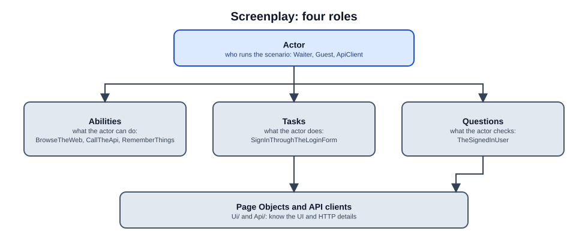

| Role | Files | What it is | Examples |
|---|---|---|---|
| **Actor** | `Screenplay/Actor.cs` | The character who runs the scenario | `Waiter`, `Guest`, `Owner` |
| **Ability** | `Screenplay/Abilities/` | What the actor can do | `BrowseTheWeb` (browser), `CallTheApi` (HTTP), `RememberThings` (memory) |
| **Task** | `Screenplay/Tasks/` | An action (`ITask`), named with a verb | `SignInThroughTheLoginForm`, `AddDishToCart` |
| **Question** | `Screenplay/Questions/` | A read or a check (`IQuestion`) | `TheSignedInUser`, `TheOrderTotal` |

### How a Task connects to the code

You describe what you see on the page in two places:

- The **Page Object (`Ui/`)** says: "The 'Add to cart' button can be found like this."
- The **Task (`Screenplay/Tasks/`)** says: "Find the dish, click the button, confirm."

A task example:

```csharp
public class AddDishToCart : ITask
{
    private readonly string _dishName;
    public AddDishToCart(string dishName) => _dishName = dishName;

    public async Task PerformAsAsync(Actor actor)
    {
        var page = actor.LookingAtThePage();
        var menuPage = new MenuPage(page);
        await menuPage.FindDishByName(_dishName).ClickAsync();
        await menuPage.ClickAddToCartButtonAsync();
    }
}
```

The step that calls this task:

```csharp
[When("the customer adds {string} to the cart")]
public async Task WhenCustomerAddsDishToCart(string dishName)
{
    await Actor.AttemptsToAsync(new AddDishToCart(dishName));
}
```

### Why this helps

- If the login form changes, you fix one `SignInThroughTheLoginForm` instead of 20 tests.
- Step definitions stay thin and simple.
- Tasks can be reused in many scenarios.

---

## 7. Project folders, one by one

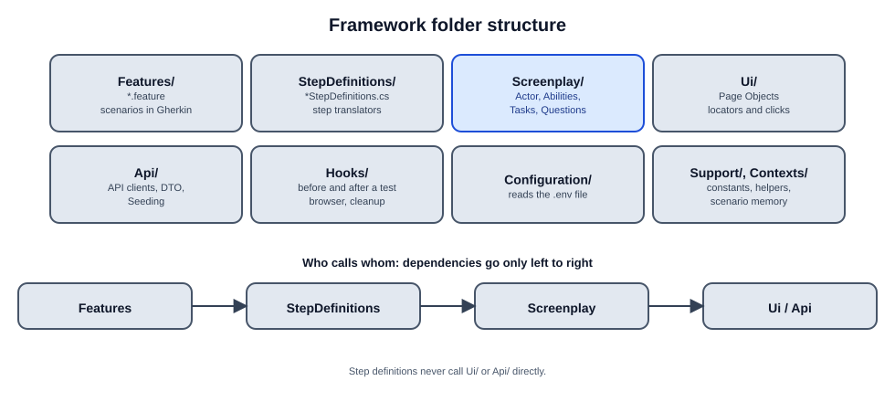

| Folder | What is inside | Who calls it | What you must not do |
|---|---|---|---|
| `Features/` | `*.feature` files in Gherkin | Reqnroll reads them | Do not write code, URLs or selectors |
| `StepDefinitions/` | `*StepDefinitions.cs`, `StepArgumentTransformations.cs` | Reqnroll, by text match | Do not put locators, logic or data here |
| `Screenplay/` | `Actor.cs`, `Abilities/`, `Tasks/`, `Questions/` | The steps | This is where the action logic lives |
| `Ui/` | Page Objects (`LoginPage.cs`, `MenuPage.cs`), `Components/` | Only Tasks and Questions | Do not make asserts here, and do not call from steps |
| `Api/` | `*Api.cs` (one per resource), `Dtos/`, `Seeding/` | Tasks, Questions, Seeding | Do not call directly from steps |
| `Hooks/` | `ScenarioStageHooks.cs`, `PlaywrightRunHooks.cs` | The framework, before and after tests | Do not change without a good reason |
| `Configuration/` | `Settings.cs`, `EnvConfig.cs` | Everyone who needs addresses and logins | Do not keep secrets in code |
| `Support/` | `InvalidInputs.cs`, `Fields.cs` | The tests | Constants and bad data sets for negative tests |
| `Contexts/` | Shared contexts, scenario memory | Hooks, Actor | |

**Key rule:** dependencies go one way only: `Features → StepDefinitions → Screenplay (Tasks/Questions) → Ui / Api`. Steps never touch `Ui/` directly.

---

## 8. Where the locators come from: Page Objects in Ui/

### It is not a copy of the frontend

The files in `Ui/` are **not copied** from the website. They are **C# code** that tells the robot how to find elements on the running page. There are no `.html`, `.js`, `.jsx` or React files in there.

### What a Page Object is

A **Page Object** is a class that represents one page (or one component) of the site. Inside it you keep the locators and the basic actions. One class = one page.

Why: if developers change the `id` of a field, you fix **one place** in `LoginPage.cs`, not 20 tests.

### How to get a locator

There are two ways:

1. **F12 in the browser.** Open your running site, press F12, look at the HTML of a button or field, and take its role, name, or `data-testid`.
2. **Playwright codegen.** Run the command from the README in PowerShell: `playwright.ps1 codegen <site address>`. A browser opens. You click like a user, and Playwright records the actions and writes C# locator code for you.

### Locator priority

Playwright recommends this order:

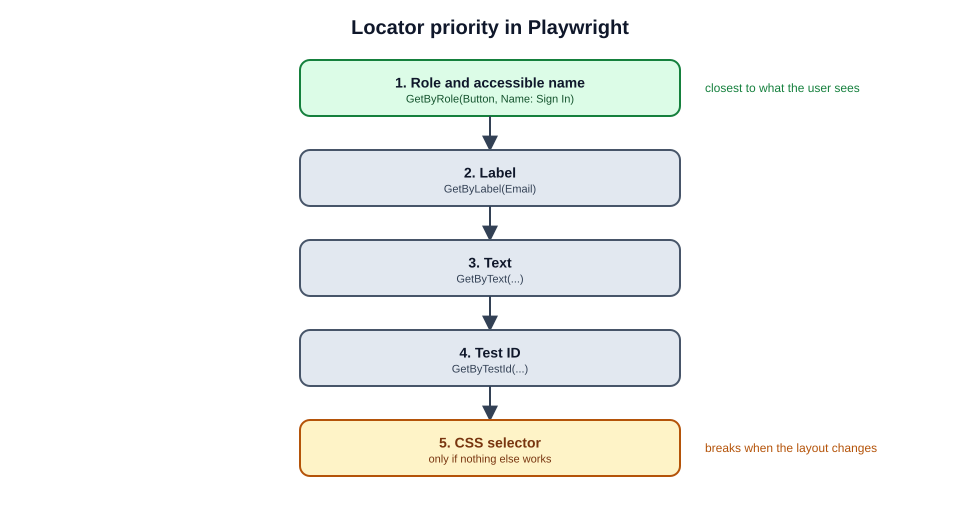

Why: a role and a name are close to how a user sees the page. CSS selectors break when the layout changes.

### Waiting without Thread.Sleep

Playwright waits for elements by itself (auto-waiting). Do not use `Thread.Sleep`. Use asserts that retry:

```csharp
await Expect(page.GetByText("Order submitted")).ToBeVisibleAsync();
```

### Why C#

The framework is written in C#. Playwright has an official C# library, so all browser instructions are written in C# too. The same code in Java looks almost the same. Only the syntax changes.

---

## 9. Test data, Seeding and cleanup

### Where the data comes from

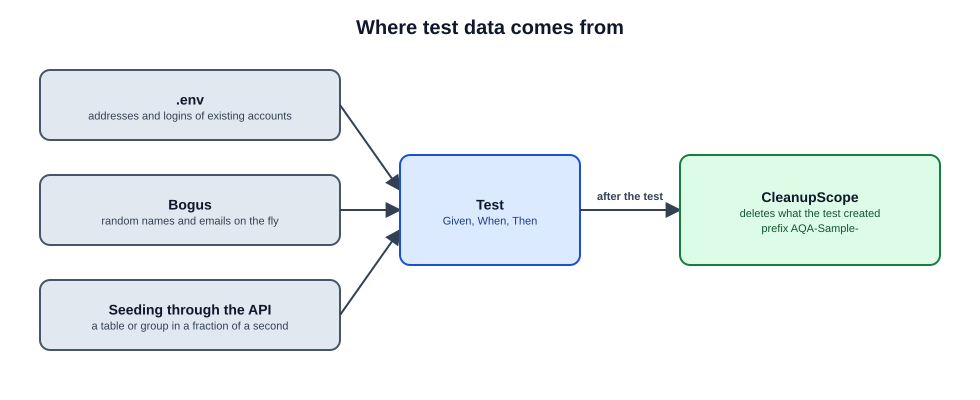

1. **`.env`**: accounts and addresses that already exist in the system (for example, a waiter or an admin).
2. **Bogus**: makes unique data while the test runs, so tests do not clash.
3. **Seeding through the API**: quickly creates what a test needs (a table or a group) with one HTTP request, instead of many clicks in the UI.

### Prefix and isolation

- Every object created by a test gets the prefix **`AQA-Sample-`**. This makes the test data easy to find.
- The environment is **shared**. Tests must not depend on the order they run in.
- Parallel runs are limited by the `MAX_PARALLEL_TESTS` variable.
- Unique emails can be made with a GUID or the current time.

### CleanupScope: automatic cleanup

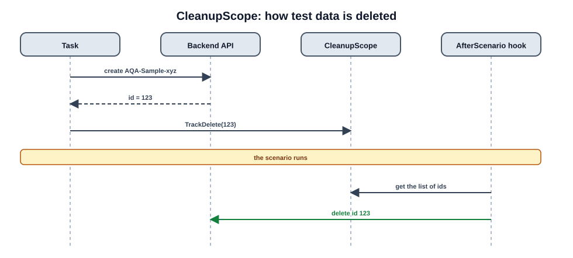

Each task that creates something registers it with `TrackDelete`. After the scenario, a hook goes through the list and deletes everything. This keeps the database clean.

---

## 10. Actor memory: Remember and Recall

### The problem

Steps in one scenario must share data. For example, step 1 creates a group, and step 3 needs its ID.

**Do not** store data in private fields of the `StepDefinitions` class or in `static` variables. Reqnroll creates new class instances, and tests run in parallel. The data would get mixed up.

### The solution: actor memory

```csharp
// Step 1: save it
Actor.Remember(reservation);

// Step 3: read it
var reservation = Actor.Recall<ReservationResponse>();
```

The memory lives in the `RememberThings` ability. It belongs to one actor and one scenario. Parallel scenarios cannot see each other's data.

---

## 11. Hooks and the scenario lifecycle

**Hooks** are methods that the framework calls by itself before and after each scenario (or the whole run).

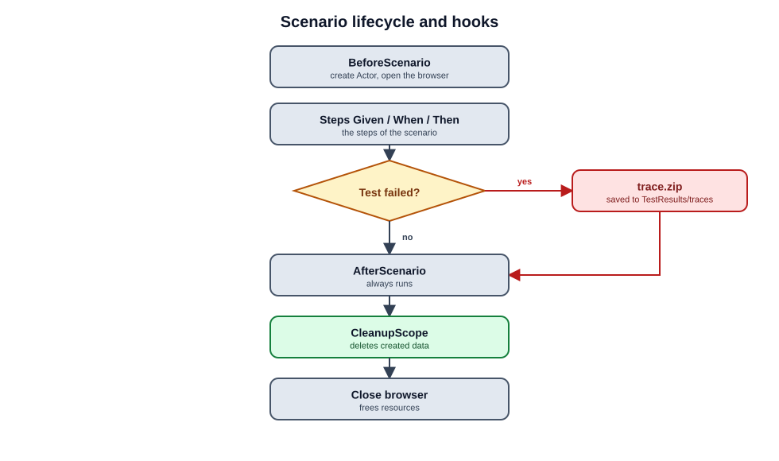

### Trace

If a UI test fails, Playwright saves a `.zip` trace in `TestResults/traces/`. It contains:

- a frame-by-frame recording of the screen;
- the DOM tree at each moment;
- all network requests.

Open it with:

```bash
npx playwright show-trace <file>.zip
```

This is the main way to find out why a test failed.

---

## 12. Types of tests

### The test pyramid

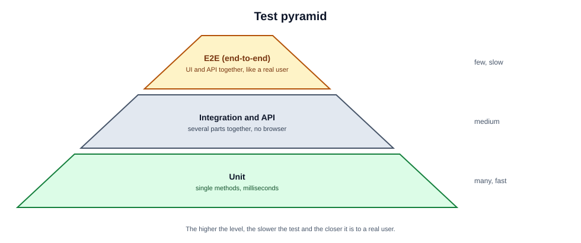

Going from bottom to top, there are fewer tests, and they get slower and closer to the real user.

### Table of test types

| Type | What it checks | Speed | Where it is used here |
|---|---|---|---|
| **Unit** | One method or class, alone | Milliseconds | Developers write these. The AQA project barely uses them |
| **Integration** | Several parts together (backend and database) | Fast | Often done with API tests |
| **E2E (end-to-end)** | The full user scenario | Slow | Your homework is E2E |
| **UI** | Work through the browser: clicks, visibility | Slow | Tag `@ui` |
| **API** | HTTP requests and responses (200, 400, 404) | Fast | Tag `@api` |
| **Smoke** | The basic critical functions: does the site open, can a user sign in | Fast | Tag `@smoke` |
| **Regression** | New changes did not break old features | Depends | The full test set |
| **Positive** | Everything is done correctly, the system works | | Normal scenarios |
| **Negative** | Errors and wrong actions, the system reacts correctly | | Tags `@negative`, `@validation` |
| **Known defect** | A test for a known bug in the app | | Tag `@known-defect` |
| **WIP (work in progress)** | The scenario is still being written | | Tag `@wip` |

### Where the word "smoke" comes from

An engineer assembled a circuit board and plugged it in. If smoke came out, there was no point testing further. In software it is the same: if the basic functions do not work, the build is rejected at once.

Smoke run command from the README:

```bash
dotnet run --no-build -- --treenode-filter "/*/*/*/*[Category=smoke]"
```

### A failing test is information

If a test fails because of a **real bug** in the app, do not delete it or switch it off (`@ignore`). Tag it with `@known-defect` and add a comment. Then everyone can see that the bug is in the product, not in the test.

---

## 13. Git, hooks and CI

### Basic terms

- **Git**: a distributed version control system that tracks file changes over time.
- **Hooks**: automated scripts triggered by Git when specific events occur (such as `commit-msg`, `pre-commit`, `pre-push`).
- **CI/CD**: Continuous Integration & Continuous Delivery/Deployment automation that tests, builds, and deploys code in the cloud upon pushes or pull requests.
- **Monorepo Architecture**: This repository houses the entire marathon stack together:
  - `backend/` — Serverless REST API (.NET 10, Lambda, DynamoDB);
  - `frontend/` — Client Single Page Application (Angular 22);
  - `infra/` — Cloud Infrastructure as Code (Terraform);
  - `aqa/` — Test automation framework (Reqnroll, Playwright, TUnit).

---

### Husky.Net: Local quality gates stored in the repository

By default, Git hooks live in the unversioned local directory `.git/hooks/` and are **not** shared with the team. This repository uses **Husky.Net** (declared in `.config/dotnet-tools.json`), which keeps version-controlled hooks inside `aqa/restaurant-aqa-framework/.husky/`.

#### One-time local activation

Run from the repository root:

```bash
dotnet tool restore --tool-manifest aqa/restaurant-aqa-framework/.config/dotnet-tools.json
git config core.hooksPath aqa/restaurant-aqa-framework/.husky
```

> [!NOTE]
> Setting `core.hooksPath` points Git to the framework's `.husky` folder from the root of the monorepo. The scripts use `git rev-parse --show-toplevel` to resolve paths accurately.

#### How the hooks work (Deep Analysis)

All hooks in `.husky/` are **monorepo-aware**: they inspect the Git diff before running any checks. If a commit touches only frontend or backend files, the AQA hooks exit immediately (`exit 0`), ensuring zero overhead for non-AQA workflows.

```
       git commit
           │
           ▼
   [commit-msg hook] ────────► Regex validation: type(scope): message
           │                   (Bypasses merges, reverts, and fixups)
           ▼
  [pre-commit hook]  ────────► Checks diff: touches aqa/**?
           │                   ├─ No  ──► Instant exit 0
           │                   └─ Yes ──► dotnet husky run --group pre-commit
           │                              ├─ dotnet format --verify-no-changes
           │                              └─ npx gherkin-lint on staged .feature
           ▼
       git push
           │
           ▼
    [pre-push hook]   ────────► Checks diff against upstream: touches aqa/**?
                               ├─ No  ──► Instant exit 0
                               └─ Yes ──► dotnet husky run --group pre-push
                                          └─ dotnet build (Warnings as Errors)
```

| Hook script | Task runner configuration | Trigger event | Verification & behavior |
|---|---|---|---|
| `commit-msg` | Shell script validation | Immediately after commit message is entered | Validates the **Conventional Commits** format: `^(feat\|fix\|docs\|style\|refactor\|perf\|test\|build\|ci\|chore\|revert)(\([a-z0-9._-]+\))?!?: .+`. Blocks non-compliant messages. |
| `pre-commit` | `task-runner.json` (`pre-commit`) | When running `git commit` | 1. **`format-cs`**: runs `dotnet format restaurant-aqa-framework.csproj --verify-no-changes --no-restore` on all staged `**/*.cs` files against `.editorconfig`.<br>2. **`gherkin-lint`**: runs `npx --yes gherkin-lint -c .gherkin-lintrc ${staged}` on all staged `**/*.feature` files. Any formatting or lint error blocks the commit. |
| `pre-push` | `task-runner.json` (`pre-push`) | When running `git push` | Compares current branch against upstream `@{u}`. Runs `dotnet build restaurant-aqa-framework.csproj --nologo -v q`. Because `<TreatWarningsAsErrors>true</TreatWarningsAsErrors>` is enabled, any compiler warning or broken step binding blocks the push. |

---

### Local and Cloud verification architecture

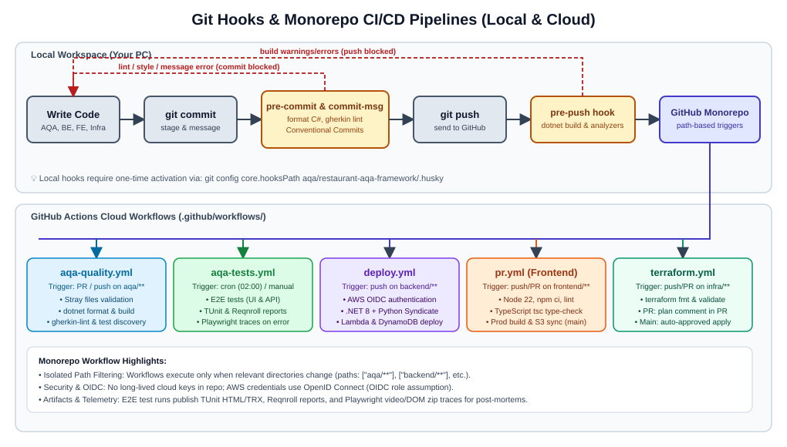

---

### GitHub Actions: The 5 Monorepo CI/CD Pipelines

GitHub Actions workflows reside in `.github/workflows/` at the **root of the repository**. Each workflow uses path filtering (`paths:`) so it triggers only when changes affect its corresponding subsystem.

| Workflow file | Trigger events | Target subsystem | Key operations & Quality gates |
|---|---|---|---|
| **`aqa-quality.yml`** | `pull_request`, `push` to `main` on `aqa/restaurant-aqa-framework/**` | Test Automation | Fast, deterministic gate without live cloud dependencies. Checks for untracked stray files (`bin/`, `obj/`, `TestResults/`), restores packages, verifies C# code formatting, compiles with zero warnings, lints Gherkin, and verifies test discovery (`--list-tests`). |
| **`aqa-tests.yml`** | `workflow_dispatch` (manual) or `schedule` (`cron: "0 2 * * *"`) | Test Automation | Runs end-to-end Playwright + Reqnroll tests against the live deployment. Supports dynamic `scope` (`all`, `ui`, `api`) or custom filter. Collects TUnit HTML/TRX reports, Reqnroll reports, and Playwright DOM/video trace `.zip` archives upon failure. Generates a markdown summary table in `$GITHUB_STEP_SUMMARY`. |
| **`deploy.yml`** | `push` to `main` on `backend/**`, `workflow_dispatch` | Backend API | Passwordless AWS authentication via OIDC (`role-to-assume`). Installs .NET 8, Python 3.11, and `aws-syndicate`. Executes `syndicate build` and `syndicate update` (fast code update) or `syndicate deploy` (full infrastructure redeploy). |
| **`pr.yml`** | `pull_request`, `push` to `main` on `frontend/restaurant-frontend-app/**` | Frontend Application | Node.js 22 setup, `npm ci`, ESLint (`npm run lint`), TypeScript strict type-checking (`tsc -p tsconfig.app.json --noEmit` and `tsconfig.spec.json`), production Angular build. On merge to `main`, synchronizes compiled assets to Amazon S3 (`aws s3 sync dist/... s3://${{ vars.S3_BUCKET }}/ --delete`). |
| **`terraform.yml`** | `pull_request`, `push` to `main` on `infra/terraform/**` | Cloud Infrastructure | Uses Terraform 1.10.5 with AWS OIDC authentication. On PR: runs `fmt`, `init`, `validate`, and `plan`, then automatically comments/updates the detailed plan in the PR via `actions/github-script`. On merge to `main`: executes `terraform apply -auto-approve`. |

---

### Deep dive into the AQA Workflows

#### 1. `aqa-quality.yml` (Deterministic PR Gate)

This workflow runs on every push and PR that modifies the test framework:
1. **Clean workspace enforcement**: Ensures that generated code-behind (`*.feature.cs`), test results (`TestResults/`), IDE metadata (`.vs/`), and binaries (`bin/`, `obj/`) are never tracked by Git.
2. **Deterministic build**: Builds with `--configuration Release` and `--no-restore` following `dotnet format --verify-no-changes`.
3. **Test discovery verification**: Runs `dotnet bin/Release/net10.0/restaurant-aqa-framework.dll --list-tests` to ensure every Gherkin step has an unambiguous binding in `StepDefinitions/`.

#### 2. `aqa-tests.yml` (Live E2E Execution & Reporting)

Because end-to-end tests interact with live cloud resources, they run on-demand or nightly:
1. **Environment resolution & secret masking**: Dynamically merges repository secrets and variables into environment variables (`UI_URL`, `API_URL`, `WAITER_USERNAME`, etc.) while masking credentials using `::add-mask::`.
2. **Fault-tolerant artifact collection**: The test execution step has `continue-on-error: true`. Even if tests fail, subsequent steps (`if: always()`) upload:
   - **TUnit reports & TRX logs** (`TestResults/*-report.html`, `*.trx`);
   - **Reqnroll reports** (`TestResults/reqnroll/`);
   - **Playwright trace archives** (`TestResults/traces/*.zip`).
3. **Trace post-mortem**: A failed UI test records screenshots, DOM snapshots, network calls, and console logs. Download the trace artifact and inspect it locally:
   ```bash
   npx playwright show-trace <trace-file>.zip
   ```
4. **Summary dashboard**: A built-in Python script parses the generated TRX XML report and outputs an executive summary table directly into the GitHub Actions run summary page.
5. **Final gate**: Step `Fail the job if tests failed` asserts the final exit status so the pipeline reflects failure only after all artifacts are safely published.

---

### Cloud Secrets and Variables Configuration

To run cloud pipelines successfully, configure variables and secrets in GitHub under:  
**Repository Settings → Secrets and variables → Actions**

```
                     ┌──────────────────────────────────────────────┐
                     │          GitHub Actions Context              │
                     ├──────────────────────┬───────────────────────┤
                     │   Variables (vars)   │   Secrets (secrets)   │
                     ├──────────────────────┼───────────────────────┤
AQA Framework        │ AQA_UI_URL           │ AQA_WAITER_USERNAME   │
                     │ AQA_API_URL          │ AQA_WAITER_PASSWORD   │
                     │ AQA_TESTTABLE_ID     │ AQA_ADMIN_USERNAME    │
                     │                      │ AQA_ADMIN_PASSWORD    │
Backend Deploy       │                      │ AWS_DEPLOY_ROLE       │
Frontend CI/CD       │ BACKEND_URL          │ AWS_DEPLOY_S3_ROLE    │
                     │ S3_BUCKET            │                       │
                     │ AWS_REGION           │                       │
Infrastructure (IaC) │ ALERT_EMAILS         │ AWS_TERRAFORM_ROLE    │
                     └──────────────────────┴───────────────────────┘
```

> [!TIP]
> **OpenID Connect (OIDC) Security**: Notice that cloud deployments (Backend, Frontend, and Terraform) do **not** use permanent `AWS_ACCESS_KEY_ID` or `AWS_SECRET_ACCESS_KEY`. Instead, they request temporary credentials via AWS IAM Roles (`role-to-assume`), authenticating cryptographically via GitHub's OIDC identity provider (`id-token: write`).

---

### Important: Monorepo folder layout & `.github/` location

> [!IMPORTANT]
> GitHub Actions **only discovers workflows located in `.github/workflows/` at the root of the Git repository**. 

If the AQA framework resides in `aqa/restaurant-aqa-framework/`, keep `.github/` at the root:
```text
epam-it-marathon-2026/          <-- Repository Root
├── .github/
│   └── workflows/
│       ├── aqa-quality.yml     <-- defaults.run.working-directory: aqa/restaurant-aqa-framework
│       ├── aqa-tests.yml       <-- defaults.run.working-directory: aqa/restaurant-aqa-framework
│       ├── deploy.yml          <-- defaults.run.working-directory: backend/restaurant-backend-app
│       ├── pr.yml              <-- defaults.run.working-directory: frontend/restaurant-frontend-app
│       └── terraform.yml       <-- working-directory: infra/terraform
├── aqa/
│   └── restaurant-aqa-framework/
│       ├── .husky/             <-- Activated via: git config core.hooksPath aqa/restaurant-aqa-framework/.husky
│       ├── Features/
│       └── StepDefinitions/
├── backend/
├── frontend/
└── infra/
```

Inside the workflows, each job defines `defaults.run.working-directory` matching its target subsystem, allowing seamless monorepo orchestration without path conflicts.

---

## 14. Comparison with Java

| Concept | C# (this project) | Java | Same everywhere? |
|---|---|---|---|
| Scenario language | Gherkin, `.feature` | Gherkin, `.feature` | Yes, the same text |
| BDD engine | Reqnroll | Cucumber for Java | The idea is the same, the library is different |
| Browser | Playwright for .NET | Playwright for Java (or Selenium) | Yes, the APIs look alike |
| Pattern | Screenplay | Serenity BDD or your own Screenplay | Yes |
| Runner | TUnit / NUnit | JUnit 5 / TestNG | No, depends on the platform |
| Language | C# 10 / .NET 10 | Java 17 / 21 | No, the syntax differs |

The same step written in Java:

```java
@When("the waiter signs in with the correct password")
public void whenWaiterSignsIn() {
    OnStage.theActorCalled("Waiter").attemptsTo(
        SignInThroughLoginForm.withCredentials(username, password)
    );
}
```

```java
public class LoginPage {
    private final Page page;
    public LoginPage(Page page) { this.page = page; }

    public void enterEmail(String email) {
        page.getByRole(AriaRole.TEXTBOX, new Page.GetByRoleOptions().setName("Email")).fill(email);
    }
}
```

**Conclusion:** Gherkin, Screenplay, Page Objects and Playwright are the same all over the world. Only the library names and the language syntax change.

---

## 15. Project rules (CLAUDE.md) in short

| Topic | Rule |
|---|---|
| Structure | Features only has Gherkin. Step definitions are thin. Logic lives in Screenplay. Ui and Api are called only from tasks and questions |
| Gherkin | Declarative, no URLs, status codes, JSON, IDs or selectors. Tags `@ui` or `@api` are required |
| Steps | At most one actor call per step. Asserts only in `Then`. Data only through `Actor.Remember` and `Actor.Recall` |
| Locators | Role, label, test ID; CSS only as a last resort. No `Thread.Sleep` |
| Data | Prefix `AQA-Sample-`. Everything created is registered with `TrackDelete` |
| Failing test | Do not delete it. Tag it `@known-defect` with a comment |
| Linter | Run `npx gherkin-lint` before you finish |

---

## 16. Working with an AI assistant

Advice from CLAUDE.md. It is useful for you and for the assistant:

- Give a specific task and one nearby example, not the whole repository.
- Before you create a new step, search for an existing one.
- Run the smallest set of tests that checks your change.
- When a test fails, share the exact error line and the log, not the whole wall of text.
- Start a new chat for each separate task.

---

## 17. Glossary

| Term | Meaning |
|---|---|
| **AQA** | Automation QA: test automation |
| **E2E** | End-to-end: a test of the full user path |
| **UI / API test** | Through the browser / through HTTP requests |
| **Framework** | A ready structure with shared tools, where you add your logic |
| **Gherkin** | The text format for scenarios: Given, When, Then |
| **Feature / Scenario** | A module / one situation inside a module |
| **Step definition** | A C# method linked to a `.feature` phrase by an attribute |
| **Reqnroll** | A BDD engine that connects Gherkin to C# code |
| **Playwright** | A library that controls browsers and sends HTTP requests |
| **TUnit** | A test runner: runs tests and builds reports |
| **Screenplay** | A pattern made of Actor, Ability, Task and Question |
| **Actor** | The character who runs a test |
| **Ability** | What an actor can do (browser, HTTP, memory) |
| **Task** | An action of an actor |
| **Question** | A read or a check for an actor |
| **Page Object** | A class for one page, with its locators |
| **Locator** | A way to find an element on a page |
| **Seeding** | Fast creation of test data through the API |
| **CleanupScope** | A list of created objects that gets deleted after the test |
| **Hook** | Code that runs before or after a scenario |
| **Trace** | A recording of a UI test run, used for debugging |
| **Smoke** | A basic test of the critical functions |
| **Regression** | A check that old features still work after new changes |
| **Known defect** | A tag for a test of a known bug in the app |
| **Git hook** | A script that Git runs on an event (commit, push) |
| **Husky** | A tool that stores hooks inside the repository |
| **CI / CD** | Continuous Integration / Continuous Delivery: automatic checks and delivery |
| **GitHub Actions** | A cloud service that runs pipelines defined in `.yml` files |
| **Pipeline / Workflow** | The list of automatic steps defined in a `.yml` file |
| **Runner** | The virtual machine that runs a pipeline |
| **Secrets** | Protected values in GitHub settings (passwords, addresses) |
