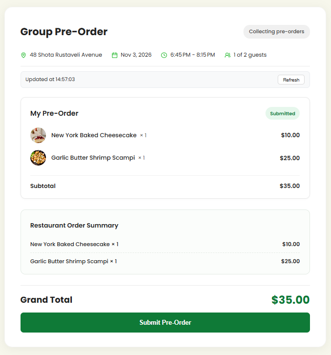
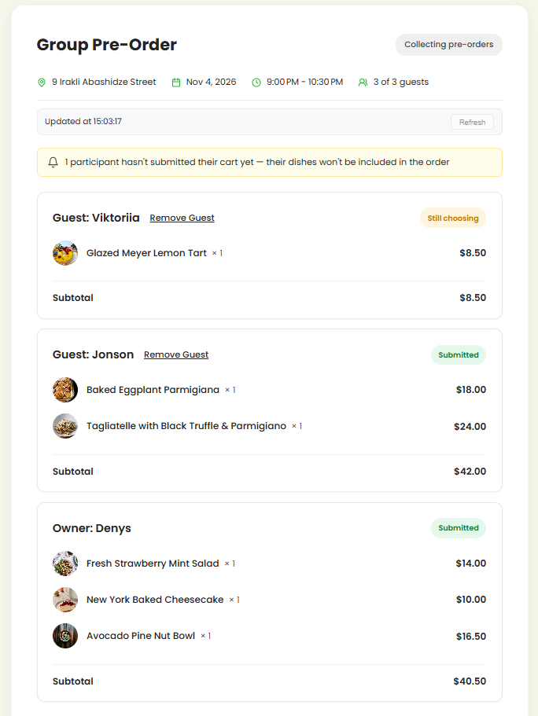
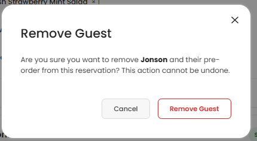
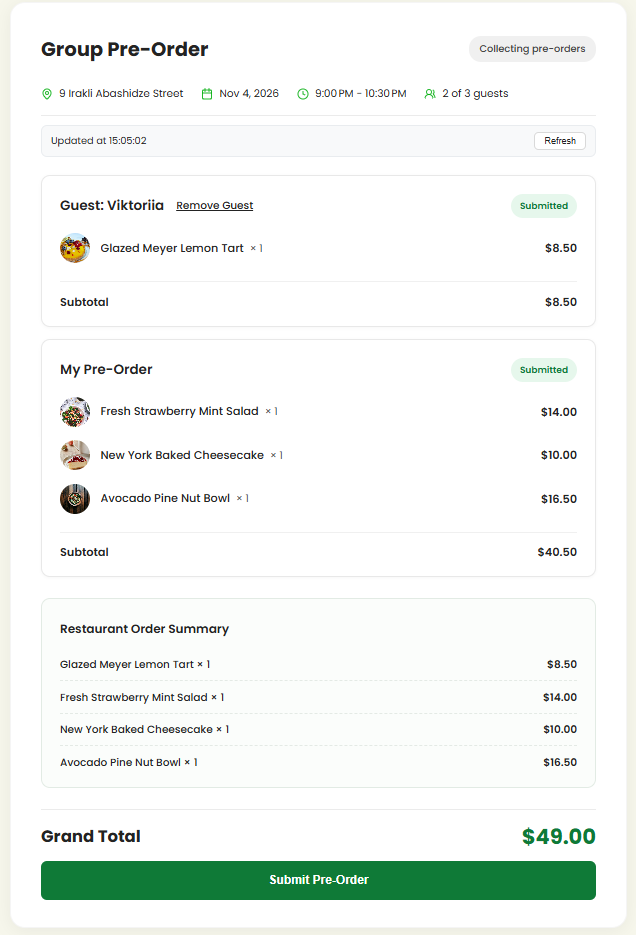
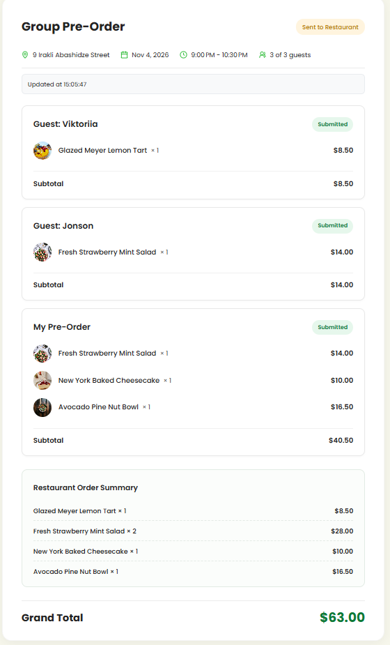
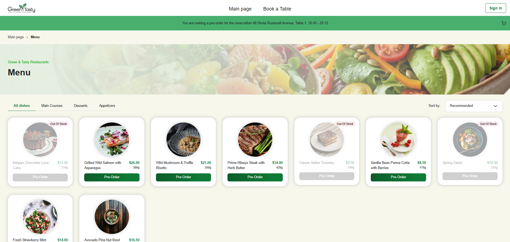

# Frontend & Backend Integration Report: Group Pre-Order Management

- **Task Specifications:** [homework-frontend.md](homework-frontend.md) | [homework-backend.md](../backend/homework-backend.md)
- **Stack:** Angular 22, TypeScript, SCSS, RxJS, .NET 10, Amazon DynamoDB, AWS API Gateway
- **Development Tool:** Google Antigravity IDE
- **Status:** Complete (Practice, Level 1, Level 2, Level 3, Level 3 Bonus)
- **Quality Gates:** Build: 0 errors | Type Check: 0 errors | Automated Tests: 100% passed | Manual QA: Verified

---

## 1. Delivery Matrix

| Level | Component / Route / Endpoint | Delivered Capabilities | Verification |
| :--- | :--- | :--- | :--- |
| **Practice** | • `app-participant-card` • `GroupOrderPageComponent` • `/reservations/:id/group-order` | • Base participant card component (`input.required`, `computed`) • Route registration and list rendering | 8/8 tests passed |
| **Level 1** | • `group-order-page.component.html` • `group-order-page.component.scss` • `participant-card.component.scss` | • Semantic markup: `<main>`, `<h1>`, `<ul>`/`<li>`, `<article>` • Group order header: address, date, time, "N of M guests" • Grand Total formatted via `currency` pipe • Responsive layout down to 375px mobile viewport • Cart status indicators (Submitted / Still choosing) • Styling aligned with Figma mockup | 13/13 tests passed |
| **Level 2** | • `GroupOrdersService` • `POST /group-reservations/{id}/submit` • `GET /guest/groups/{id}/sessions` • `GET /reservations/{id}/guest-session-id` • `GET /guest/groups/{id}/status` | • Signal-based state architecture (`signal()`, `computed()`) • Identification of Owner card ("My Pre-Order") • Consolidated pre-order calculation (`consolidatePreOrder`) • Grand Total calculated strictly from submitted carts • Unsubmitted participants warning banner • Status badges: "Collecting pre-orders" / "Sent to Restaurant" • Submit pre-order confirmation modal (`<app-modal>`), double-click lock, read-only mode transition | 18/18 tests passed |
| **Level 3** | • AWS API Gateway integration • Real Cognito authentication • Background sync polling | • Real backend integration via environment `backendUrl` • Silent 15s polling via RxJS (`timer`, `exhaustMap`) when `Open` • In-place data updates (`SKIP_ERROR_TOAST`) without screen flicker • "Updated at HH:mm:ss" indicator and manual "Refresh" button • Network error resilience (retains latest valid snapshot) • API error handling with toast notifications | 9/9 tests passed |
| **Bonus** | • `DELETE /guest/groups/{id}/sessions/{guestId}` • Remove Guest action | • "Remove Guest" action on guest cards (`type === 'Guest'`) • Accessible button markup (`aria-label="Remove [Name]"`) • Confirmation dialog via `<app-modal>` • Instant Signal-driven recalculation of participants and totals | 6/6 tests passed |

---

## 2. Database Seeding & Media Assets

- **Database Seeds:** Automated scripts and batch datasets created in `backend/restaurant-backend-app/seed/`:
  - `seed-aws-cli.ps1` & `seed-users.ps1`: Automated DynamoDB and Cognito seeding.
  - `clean-dynamodb.ps1`: Safe data reset and purge tool.
  - DynamoDB tables populated: `Locations`, `Dishes`, `Tables`, `Waiters`, `Feedback`, `Users`.
  - Pre-seeded test accounts: Customer (`customer@greentasty.com`), Waiters (`waiter@greentasty.com`), Admin (`admin@greentasty.com`).
- **Dish Images:** Square photography assets added under `frontend/restaurant-frontend-app/src/assets/img/dishes/` matching DynamoDB dish IDs and types.

---

## 3. Verification & Testing

- **Antigravity IDE:** Used throughout planning, implementation, refactoring, and verification phases.
- **Automated Tests:** 100% pass rate across all homework test suites:
  - `npx tsc -p tsconfig.app.json --noEmit` — 0 errors
  - `npx tsc -p tsconfig.spec.json --noEmit` — 0 errors
  - `npm run build` — Production build passed
  - `npm run test:hw` — All Practice, Level 1, Level 2, Level 3, and Bonus tests passed
- **Manual QA Testing:** End-to-end guest and owner reservation workflows tested manually.
  - **QA Report:** [homework-qa-report.md](../qa/homework-qa-report.md)
  - **Test Cases & Defect Log:** [homework-qa.xlsx](../qa/homework-qa.xlsx)

---

## 4. Screenshots

### Owner Pre-Order Review

### Group Pre-Order with Guests & Unsubmitted Warning Banner

### Remove Guest Confirmation Modal

### State After Guest Removal & Recalculation

### Group Pre-Order Sent to Restaurant (Read-Only)

### Restaurant Menu with Seeded Dishes & Photos

